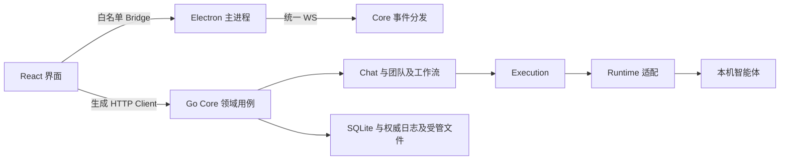

# 架构总览

NeuxAlly 是本地优先的伙伴工作台。Electron 承载桌面能力，React 承载界面，Go Core 拥有业务规则、执行与持久化，智能体适配隐藏原生 CLI 的协议差异。

## 所有权

- Chat 保存消息权威日志与原生会话关联；Execution 管理接纳、执行、取消和失败恢复。
- Channel 管理团队成员、任务与协作；Workflow 管理源码版本、编译产物和运行状态。
- 自动任务和 IM 管理触发、授权及交付关系，复用已有执行入口。
- 伙伴、项目、插件、技能、连接器、账号和记忆各自维护其业务事实。
- 工作看板与通知读取原领域状态，不复制执行生命周期。

前端服务器事实由 TanStack Query 管理，资源事件用于增量更新或精确失效。Electron 主进程持有一条 Core WebSocket；文件与 Git 使用原生监听。普通业务操作继续使用 REST。

## 代码导航

| 路径                | 职责                                  |
| ------------------- | ------------------------------------- |
| desktop/src/app     | 路由、Scene 和跨模块装配              |
| desktop/src/modules | 产品领域界面与查询                    |
| desktop/src/shared  | 组件、API、主题与桌面适配             |
| desktop/electron    | 主进程、preload、契约与原生能力       |
| server/apis         | HTTP Operator、校验及单入口用例       |
| server/services     | 多入口复用业务与后台生命周期          |
| server/repositories | 持久化模型、查询及事务实现            |
| server/internal     | Runtime、日志、文件、编译器等内部能力 |
| skills/ally         | 随应用交付的系统任务知识              |

当前交付方式是本机应用与回环 Core。内部的 allycli 和 ALLY_* 环境变量是技术契约，产品与仓库名称为 NeuxAlly。受管文件根目录与程序数据目录分别管理，具体布局见 [工作区与存储](workspace-and-storage-cn.md)。

修改前阅读根目录 AGENTS.md，具体数据边界见 [工作区与存储](workspace-and-storage-cn.md)。

插件资源、伙伴安装、共享授权与版本快照见 [插件资源](plugin-resources-cn.md)。

知识库的独立核心、SQLite 权威、原件与本地／远端执行边界见 [知识库](knowledge-cn.md)。
