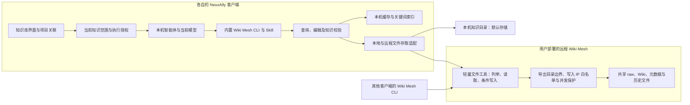
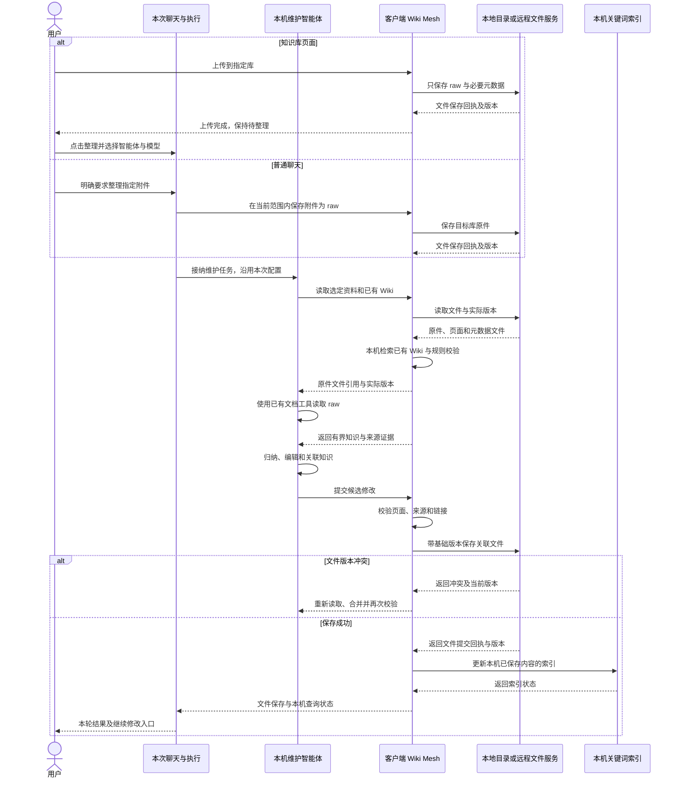

# 知识库与 LLM Wiki：领域与行为规格

> 状态：讨论草稿。本文区分已确认需求、设计建议和待定事项，不描述当前已交付能力，也不构成开始实现的授权。
> 范围：共同设计 NeuxAlly 系统级知识库与 Wiki Mesh 内置插件，覆盖通用及项目知识、默认本地存储，以及连接用户自部署轻量文件服务的远程共享。

## 1. 目标与已确认范围

用户将文档交给知识库，智能体把资料整理为可持续维护、相互关联且能够追溯来源的 Wiki。后续任务检索 Wiki，按需回到原始资料核对；第一版使用目录、别名和关键词检索。

以下来自本次讨论，作为后续设计的需求基线：

| 编号 | 已确认需求 |
| --- | --- |
| R01 | 知识库是系统级资源，伙伴是使用者；不建立伙伴拥有或逐个挂载知识库的关系 |
| R02 | 知识库分为通用类型和项目类型 |
| R03 | 通用知识库不属于任何项目，各伙伴根据任务相关性自主选择查询 |
| R04 | 项目知识库关联项目，只有在该项目的工作范围中执行任务时才提供对应知识入口 |
| R05 | 上传的 PDF、Word、Markdown 等文件都是 raw；Wiki 是在这些来源之上逐步整理和维护的知识 |
| R06 | 通用类型有独立的文档维护规则，关注概念、主题和资料之间的关联关系 |
| R07 | 软件工程类以 Wiki Mesh 的 DevWiki Demo 为参考，与本次知识库需求共同设计，通过项目代码与资料维护项目知识 |
| R08 | 向智能体提供可用知识库的说明和 CLI，智能体按需查询，正文不整库注入 |
| R09 | 复用 Wiki Mesh CLI 与对应 Skill；需要通用文档类的查询、编辑、核查和维护能力，也保留软件工程类能力 |
| R10 | 第一版不加入 embedding，不要求向量检索、本地向量模型或独立向量服务 |
| R11 | 本阶段先写规格并讨论领域概念，未确定事项继续与用户讨论 |
| R12 | 不同伙伴分别创建了指向同一代码仓的项目时，共用一套项目知识库；进入各自对应项目后使用同一份知识 |
| R13 | 知识库页面上传只保存为 raw；用户手动点击整理，并选择智能体（CLI）、模型等执行配置后，处理新增资料 |
| R14 | 普通聊天中，用户明确要求把上传文件整理到 Wiki 时也支持执行；使用当前聊天的智能体与模型 |
| R15 | 整理默认增量处理新增资料，不因再次点击整理而重新处理全部历史原件 |
| R16 | 知识库整理采用类似工作流创作的交互：右侧保留聊天框，用户可以继续对话，要求修改和完善整理结果 |
| R17 | Wiki Mesh 现有设计与 Skill 处于 Demo 阶段，现有目录、类型、模板和命令不是本次方案的冻结约束；两项目一起完善知识库设计 |
| R18 | Wiki Mesh 作为 NeuxAlly 内置插件，提供本地知识存取和连接远程知识服务的能力 |
| R19 | 远程共享需要用户自行部署 Wiki Mesh 程序；NeuxAlly 与该程序通信，多个客户端可以访问同一远程知识库 |
| R20 | 远程共享者均可参与上传、整理和修改，必须避免并发覆盖；支持开启写入 IP 白名单，开启后仅白名单来源 IP 可以执行修改动作 |
| R21 | 第一版默认本地存储 Wiki，同时支持连接远程 Wiki；查询和编辑由各客户端 CLI 提供，原件阅读与整理使用当前智能体的既有能力 |
| R22 | 第一版远程 Wiki Mesh 只是类似 MCP 工具服务的轻量文件共享端，不执行模型、知识整理或知识检索；提供文件存取及必要的写入保护 |
| R23 | 两类 Wiki 均以主题为导航主轴，页面类型作为筛选，不以类型固定划分一级目录 |
| R24 | 首版支持手动整理与可选的现有定时任务，不因代码变化自动触发模型整理 |
| R25 | 首版资料范围为文本型 PDF、DOCX 和 Markdown，使用当前智能体已有文档阅读能力；不新增格式转换服务，OCR、复杂图表及旧版 DOC 留待后续 |
| R26 | 移除来源默认归档并保留原件、Wiki 与历史引用；彻底删除为独立操作 |
| R27 | raw 保留原始文件，智能体按 LLM Wiki 规则读取后生成与维护 Markdown Wiki；不要求每份 PDF／Word 先转换为一份 Markdown |
| R28 | 设计覆盖 i18n，并明确软件类的其他主题、资料内容的归属，以及通用文档 Skill 的编写与设计 |

R09、R18 与 R19 是目标需求，不代表现有 Demo 已具备完整读写接口、远程知识服务或插件交付机制。共享维护和 IP 白名单的已确认规则见 8.4；客户端处理和远程文件服务的已确认边界见 R21、R22。

## 2. 现有实现与拟新增边界

以下依据本次本地源码核查：NeuxAlly 基线 `4fb33f8`，Wiki Mesh 基线 `67f17c2`。这是源码观察，不代表跨仓集成、真实模型调用或桌面操作已经验收。

| 边界 | 当前实现 | 本次拟新增 |
| --- | --- | --- |
| 项目与执行身份 | [Project](../../server/repositories/models/project.go) 由伙伴拥有；[Chat](../../server/repositories/models/chat.go) 保存稳定项目身份及冻结目录范围 | 系统知识库及项目关联，在任务接纳时解析知识范围 |
| 软件能力 | [能力授权](../../server/internal/agentcapability/registry.go) 已有 Execution 身份、精确操作绑定及回执；[系统技能](../../skills/ally/SKILL.md) 说明发现与调用方法 | Wiki Mesh 接入同一受管身份及授权边界 |
| 持续创作 | [工作流创作](../../server/apis/workflows/send_creation_message.go)复用普通 Chat 和逐轮 Execution；[创作会话](../../server/repositories/models/workflow_creation.go)关联真实聊天、所选或内置执行身份与保存回执 | 知识库维护对话采用相同的聊天复用和逐轮保存模式，绑定自己的知识库与版本 |
| Wiki Mesh 类型 | `internal/app/skillapp/source.go` 当前仅注册 `devwiki`，初始化和校验也有工程场景约束；属于待共同完善的 Demo | 两类知识的页面模型、导航、模板、摄入与校验规则一起设计，不以既有硬编码目录为产品约束 |
| Wiki Mesh 检索 | `pkg/qmd` 提供公开 Go SDK；关键词检索可独立使用，embedding 配置为空或 `none` 时不创建向量模型 | 对两类知识库提供有界关键词检索及来源阅读 |
| 原件阅读 | `pkg/qmd/extract/extract.go` 当前仅注册 Markdown，适合索引整理后的 Wiki | 原件交给当前智能体已有文档能力读取；不为此扩建 PDF／Word 转换器或 qmd 原件解析 |
| 写入与维护 | DevWiki Skill 编排摄入和维护，部分动作通过页面文件编辑完成；不能将 Skill 描述视为已有 CRUD 命令 | 整理本地与远程一致的受管读写、校验、版本与变更提交契约 |
| 远程存取 | `internal/app/wikiapp/config.go` 已有 local/remote 来源配置；`ResolveRoot` 只接受本地来源，当前 read/search 链路不能据此当成已支持远程 | 用户可部署的轻量文件服务；客户端通过文件协议完成远程资料与页面的存取 |
| daemon | `internal/app/daemonapp/server.go` 当前提供智能体及 session 接口 | 新增独立的轻量文件存取入口；不复用 agent/session 接口作为知识执行服务 |
| 运行与调度 | Wiki Mesh 已有 `pkg/agent`、`agent run` 与 `daemon`；NeuxAlly 已有 Execution、Runtime 和自动任务 | NeuxAlly 内的知识维护复用已有执行和调度，不并行接管两套智能体生命周期 |

跨仓复用遵守 Wiki Mesh 的公开包边界；NeuxAlly 不导入另一 Go module 的 `internal` 包。当前公开 qmd SDK 可以作为候选复用点，Wiki 通用读写能力是否需要公开 SDK 留给实现设计评估。

## 3. 领域概念

| 概念 | 定义与约束 |
| --- | --- |
| 知识库 | 系统内具有稳定身份、类型、用途及独立知识内容的资源；可在本地或远程存取，展示名称可以修改 |
| Wiki Mesh 内置插件 | 随 NeuxAlly 交付的知识能力边界，面向用户提供本地与远程知识访问，面向智能体提供 CLI 与 Skill；具体打包与进程形态待设计 |
| 文件存储端 | 本地知识文件目录，或远程 Wiki Mesh 导出的共享目录；远端只提供文件工具，不解释知识语义 |
| 远程连接 | 本机保存的服务地址、认证及连接配置；连接本身不是知识库，也不拥有远程内容 |
| 知识库接入记录 | NeuxAlly 对本地或远程知识目录的引用，用于界面和本机项目关联；内容身份由共享目录内的知识元数据表达 |
| 通用知识库 | 使用文档类 Wiki 规则、不关联项目的知识库 |
| 项目知识库 | 使用软件工程 Wiki 规则、由项目关联确定使用范围的知识库 |
| 项目关联 | 项目与知识库之间的使用关系；不同伙伴的项目可以关联同一知识库，复用同一份内容与版本 |
| 原始资料 raw | 用户提供的证据原件；维护 Wiki 时只读，替换资料形成可区分的新版本 |
| 待整理资料 | 已保存为 raw、尚未对其当前版本完成 Wiki 整理的资料；资料保存和整理完成分别记录 |
| 原件阅读依据 | 智能体实际阅读的资料版本、可确认位置和必要原文摘录；不要求独立保存一层标准化全文 |
| Wiki 页面 | 智能体跨资料整理的知识文章；具有稳定页面身份、内容版本及来源关系 |
| 来源关系 | 页面中的知识与原件版本、位置之间的关联，支持核对和判断受影响内容 |
| 页面关系 | 概念、主题、对象、来源与综合文章之间的链接及必要说明 |
| 维护任务 | 对明确知识库和资料范围进行摄入、更新或核查的工作；具体运行归既有 Execution 管理 |
| 知识库维护对话 | 绑定明确知识库、支持多轮整理与修改的聊天入口；复用 Chat 保存消息，Wiki 内容由知识库独立保存 |
| 当前知识范围 | 一次执行实际获准发现和读取的知识库集合，由 Core 根据真实项目上下文计算 |

设计建议：第一版中两类知识库分别固定使用文档类和软件工程类规则，内置 Wiki Mesh 插件不等于增加任意第三方插件框架。类型与范围发生转换会影响页面和可见性，暂不提供原地切换。

NeuxAlly 的项目身份与 Wiki Mesh Demo 配置中的 `project_slug` 分别表示应用工作范围和 Wiki 工作区标识，接入时需要明确映射；两者不能因同名就被视为同一对象。跨客户端也不以本地目录绝对路径认定项目或知识库相同。

设计建议：知识库稳定身份随知识元数据文件保存，远程接入同时记录文件服务及导出目录，本机接入记录另有身份。地址改变不应隐式创建另一份内容；不同存储位置的同名库不能直接合并。本地与远程是存取维度，与通用／项目这一知识类型维度分别表达。

## 4. 发现、查询与项目范围

### 4.1 已确认的使用规则

| 当前工作 | 提供给智能体的知识库 |
| --- | --- |
| 没有项目的聊天或工作 | 通用知识库 |
| 项目 P 内的工作 | 通用知识库，以及与项目 P 关联的项目知识库 |
| 伙伴拥有项目 P，但当前工作没有进入 P | 通用知识库 |
| 项目 Q 内的工作 | 通用知识库，以及与项目 Q 关联的项目知识库 |

通用库是否适合本次问题由智能体判断。项目库在理解当前项目的规则、术语和已有实现时应成为优先查询的知识来源；查询次数和阅读深度仍由具体任务决定。

### 4.2 设计建议：执行级知识范围

* Core 在任务接纳时，根据伙伴身份、真实项目身份与当前关联计算可用知识库，冻结本次执行的集合。
* 智能体得到名称、用途、类型、主题或关键词，以及准确的查询入口；正文按需读取。
* 运行期间新增关联不扩大已接纳执行；后续执行重新解析配置。读取到的页面附带实际版本，本文不要求每次执行复制整库快照。
* CLI 的列表、搜索、读取、原件访问和写入都使用相同的范围校验。传入其他知识库 ID 不扩大授权。
* 关联删除、知识库删除或执行授权失效后，后续访问明确失败，不能继续依靠旧清单访问资源。
* 普通项目任务只获得必要的查询能力；修改和删除权限由明确的维护任务授权，不能从可查询推导出可修改。
* 聊天中明确要求整理文件到 Wiki 属于维护任务入口；在当前获准知识范围内确定目标及资料后，绑定相应维护权限，不能因能够查询就获得全部知识库的写入权限。
* 直接访问已有项目目录的临时文件夹任务，不凭路径自动推断为进入某个项目；项目范围以应用接纳的身份为准。

团队、工作流和自动任务沿用各自已经接纳的真实项目上下文。没有项目上下文时，不从提示词中的项目名称推导项目库权限。

接入远程后，本机仍由 Core 限定项目及执行范围；远端限定可访问的共享目录与写入 IP。远端文件服务不需要理解伙伴、项目或知识类型。系统级通用库表示不归属某个伙伴或项目，不意味着能够越过远端导出目录；连接成功也不自动获得本机代码和附件。

### 4.3 跨伙伴共享项目知识

已确认：伙伴甲、伙伴乙分别创建了指向同一代码仓的项目时，两者共用同一套项目知识库。两个项目配置仍保持各自身份，知识内容、来源与历史版本共享同一份权威文件；同一客户端复用该库的本机索引，跨客户端分别维护可重建索引。

进入甲的对应项目或乙的对应项目，都能查询这份知识库；没有进入相关项目时，仍遵守 4.1 的范围规则。解除某个项目的关联不删除共享知识库，也不影响另一个项目的有效关联。

设计建议：各项目通过稳定知识库 ID 显式关联同一资源，创建或关联时可提示已有知识库以便复用。代码仓路径用于辅助识别和推荐，不代替项目关联及执行授权；具体识别方式交给实现设计确定。

## 5. 内容分层与权威来源

| 内容 | 权威与维护方式 |
| --- | --- |
| 原始文件及其版本 | 事实证据；Wiki 整理任务不改写原件 |
| 来源位置与必要摘录 | 绑定实际原件版本及可确认位置；不伪造分页，不另设必需的转换全文 |
| 当前 Wiki 页面与页面版本 | 当前知识表达；来源提供证据，历史保留每次内容变化 |
| 目录、反向引用、关键词索引 | 从已发布内容派生，可重建；不作为第二份可编辑知识正文 |
| 维护报告和执行记录 | 解释本次操作、缺口和结果；默认不进入普通知识检索 |

知识库 ID、资料 ID、页面 ID 与各自版本用于准确定位。文件名、展示名称和 qmd collection 名称不代替业务身份。

上传 Markdown 时也保留其 raw 身份；整理后的 Wiki 页面独立维护。原始文章直接复制到 Wiki 不能代替主题归纳与关联维护。

设计建议：NeuxAlly 保存本机连接、知识库接入记录、项目关联及真实聊天执行。Wiki Mesh 客户端统一解释知识元数据、原件、页面、来源、导航和历史文件，提供查询、编辑、提交及知识规则校验；原件阅读与整理使用当前智能体已有能力。本地模式直接访问本机知识目录，默认不要求启动文件服务；远程模式通过文件工具访问用户部署的共享目录。

共享目录中的已发布文件是远程库的权威内容；客户端缓存与关键词索引是可重建的派生内容。远程服务只理解相对路径、文件内容、版本和存取限制，不维护另一套知识实体数据库，也不运行解析、qmd 索引或语义校验。

具体知识目录和版本文件组织由联合设计确定，本机接入遵守[工作区与存储约定](../architecture/workspace-and-storage-cn.md)。远端不保存 NeuxAlly 私人聊天、模型配置或本机项目配置。

## 6. 通用文档 Wiki 规则

### 6.1 页面组织

以下是建议的页面语义，技术标识与目录名尚未冻结：

| 页面 | 回答的问题 | 内容边界 |
| --- | --- | --- |
| 来源页 | 这份资料讲了什么，贡献了哪些知识 | 记录来源、关键内容和相关页面，保留回到 raw 的入口 |
| 概念页 | 某个概念是什么，与其他概念如何区分或关联 | 定义、别名、解释、边界和来源支持的关系 |
| 主题页 | 围绕某个主题，现有资料共同说明了什么 | 跨资料组织知识，关联概念、对象及尚未解决的问题 |
| 对象页 | 某个人物、组织、产品或其他明确对象有哪些已知信息 | 合并来源中可核对的信息，处理同名与别名 |
| 综合页 | 多份资料之间有哪些比较、归纳和关联结论 | 区分来源陈述、归纳结论和仍存在的分歧 |
| 参考页 | 哪些规则、条目或约束需要准确查阅 | 提供范围、内容和版本依据，不机械拆分每个字段 |
| 方法页 | 在什么条件下怎样完成一件事并核验结果 | 前提、步骤、边界及有来源支持的结果核验 |

页面按知识需要生成，不设每份资料必须生成多少页面或提取多少对象的配额。名称相近的页面需先核对含义；同一主题尽量补充已有页面，独立含义才新建。

### 6.2 摄入与增量维护

1. 通过当前智能体已有能力阅读原件，确认可读范围及可确认的来源位置。
2. 抽取关键概念、主题、对象、别名、重要陈述及关系。
3. 搜索已有 Wiki，判断新增、补充、存在分歧或没有实质新增内容。
4. 组织本次变更；每个修改绑定明确来源和目标页面的基础版本。
5. 对受影响的关联页面同步处理，更新目录与必要链接。
6. 校验内容、链接、来源和版本冲突，提交本次变更，再更新索引。

新上传不自动意味着来源结论更新或更权威；比较来源自身的时间、版本、适用范围和陈述。存在分歧时保留各自依据，不自行写成统一事实。

### 6.3 关系与核查

* 页面以链接和必要元数据维护关系；反向引用和浏览视图由这些关系派生。
* 对“支持、分歧、替代”等有事实含义的关系，保存依据和解释；普通“相关”链接只表示导航关联。
* 核查覆盖无来源陈述、失效链接、孤立页面、重复概念、别名混淆、过期内容及缺少关联的关键知识。
* 语法和链接等确定性检查由工具完成；来源是否支持结论、是否遗漏关键知识由智能体核查。
* 回答可引用 Wiki 和原件。引用至少能定位实际页面版本、资料版本和可提取的章节或片段；PDF 页码仅在阅读工具确实提供时使用，Word 不承诺稳定分页。
* 普通查询默认产生回答；把回答归档为新知识属于独立写入，仍需来源核对和明确授权。

## 7. 软件工程 Wiki 与项目协作

软件工程类以 DevWiki Demo 的主题、实现说明、排障、术语与证据规则作为设计输入，重新评估分类及维护方式。项目代码是证据来源，保留目录与代码版本关联；上传的需求、设计、说明等文件仍作为 raw 管理。

开发任务在当前项目知识范围内查询 Wiki，按需核对获准代码。维护任务根据实际代码和文档变化更新 Wiki，并记录核验的版本或时间。上传资料采用第 9 节已确认的手动或聊天入口；首版不监听代码变化自动启动整理；用户可手动发起代码核对，或使用现有定时任务明确安排维护。

NeuxAlly 的“工作流”表示可执行业务编排，DevWiki 中的工程实现页面并不自动成为可执行工作流，接入时保持两者语义清楚。

两类 Wiki 共享文件与来源管理、版本、索引和读写契约；软件工程模板与文档类模板分别维护。通用文档的概念与主题提取不沿用工程实现章节要求。

### 7.1 两类 Wiki 的规则、分类与导航

现有 Demo 的初始化模板创建 `topics/`、`workflows/`、`troubleshooting/` 以及 index、glossary、log。这些说明当前实验的页面分工，不是本次产品必须沿用的一级目录。前端原型中的功能主题、实现说明、故障排查、术语表同样是待审示例。

设计建议共同定义三层职责：

| 层次 | 职责 | 设计边界 |
| --- | --- | --- |
| 知识规则与内容模型 | 定义通用／软件类的页面语义、证据、关联、版本与默认导航规则 | 默认类型和一级分类重新讨论；不因某个旧目录已存在就冻结 |
| Skill | 指导智能体阅读来源、发现既有知识、选择归属、合并或新建页面、完善关系及核查 | 必须使用知识服务可验证的读写契约；自然语言规则不能代替版本和权限校验 |
| 前端导航 | 展示实际已发布知识的目录、页面类型、链接和数量 | 读取实际导航及元数据；不把原型示例写成生产常量 |

已确认以主题为导航主轴，页面类型作为筛选。主题按知识内容生长，软件类可围绕身份认证、资料管理等能力组织，通用类可围绕研究领域组织；普通目录分组不要求创建一篇无实质内容的 Wiki 页面。

通用类型不套用工程实现章节；软件类型区分功能语义、实现证据与排障，但其物理目录、页面格式和导航元数据按主题导航决策设计，不把旧目录作为产品约束。维护报告与执行记录继续遵守第 5 节的内容分层，不进入默认知识正文。

### 7.2 主题归属与 Skill 的设计提案

软件知识需要覆盖业务能力以外的架构、数据、接口、安全、运行交付、质量性能和工程协作。具体主题建议及文档归属示例由[联合详细设计](knowledge-base-design-cn.md#软件类主题建议与资料归属)集中维护；这些是设计建议，不是强制目录或用户已逐项确认的分类表。

原件统一保存在 raw，整理后的知识根据内容归入主题。一份需求或设计可以支持多个主题，多份不同文档可以共同更新一个页面；不能按文件类型或章节名机械建树，也不能将未经核验的需求／设计写成当前实现。

[Skill 设计与通用正文草案](knowledge-base-skills-cn.md)给出共同入口、类型规则、四类任务、通用页面内容槽位及实施验证场景。它属于设计产物，尚未安装或进行真实智能体行为验证。

### 7.3 i18n 的设计提案

界面与终端文案复用各仓现有集中资源，机器字段和身份保持语言无关；界面语言、Wiki 默认编写语言与原件语言分别表达。切换某个客户端界面语言不改写共享主题、页面或 raw，聊天回答语言也不自动改变 Wiki 内容语言。

首版新增知识模块的中英文文案、库与页面语言字段、语言选择和 fallback 方案，见[联合详细设计的 i18n 契约](knowledge-base-design-cn.md#i18n-与-wiki-编写语言)。具体默认值与语言选项是待评审提案，不代表全应用英文界面已完成。

## 8. 模块职责与 CLI 接入

此图是首版目标边界，不表示 Demo 已完成接入。远端采用类似 MCP 的文件工具服务；是否以标准 MCP 或轻量 HTTP 承载属于实现层选择，不扩展为远程知识执行平台。

### 8.1 职责与能力入口

* 已确认：NeuxAlly 管理界面、项目范围、聊天和真实执行；Wiki Mesh 客户端 CLI 提供查询、编辑、保存和核查，当前智能体使用已有能力阅读原件并按 Skill 整理。远端只存取文件及保护写入。
* 本地和远程使用同一客户端知识规则、页面模型与 Skill，区别只在文件存取后端；本地默认直接访问受管目录，不要求运行服务器。
* 知识库页面整理使用本次选择的智能体与模型；普通聊天整理沿用当前聊天。第一版不增加服务器模型配置、服务端整理任务或远程 agent 生命周期。
* 受管 CLI 仍服从当前执行范围，文件存取适配不通过全局配置扩大访问。远端导出目录不暴露任意服务器路径，连接配置不进入提示词或 Wiki 正文。
* 客户端在写入前完成页面结构、来源和关系校验；远端只校验通用的文件路径、写入来源、基础文件版本和提交一致性。远端不加载知识 Skill，也不判断 Topic、概念或来源陈述是否正确。
* CLI、知识内容模型和 Skill 需要兼容；文件服务只需声明文件工具及条件写入能力，不要求跟随每次页面分类变化升级知识模型。
* NeuxAlly 不导入 Wiki Mesh 的 Go `internal` 包；公开 SDK、CLI 和文件协议的具体划分由实现设计确定。

### 8.2 必需的业务操作

以下是客户端 CLI 与 NeuxAlly 所需的业务能力，不是远程服务器接口清单，也不是现成命令清单；具体拼写与 Schema 通过后续契约设计确定。

| 类别 | 所需操作与结果 |
| --- | --- |
| 管理 | 创建、修改知识库及项目关联；列出准确资源身份；来源移除默认归档，彻底删除独立处理 |
| 发现与查询 | 列出当前可用库；按库和实际范围搜索；返回候选身份、摘要、来源及检索模式 |
| 阅读 | 按稳定身份和版本读取页面、章节或有界片段；返回关联页面及原始证据入口 |
| 资料 | 页面上传或从获准聊天附件导入原件、读取原件与整理状态、替换版本、明确重试读取；不把上传回执解释为 Wiki 已维护完成 |
| 编辑与维护 | 准备变更、提交页面修改、合并相关知识、处理重命名或删除对引用的影响 |
| 核查 | 工具校验与智能体语义核查分别返回真实结果；未检查的部分明确记录 |
| 运行 | 接纳、查询、等待和取消维护任务；返回既有执行身份与最终内容变更结果 |

读操作报告真实搜索范围和实际模式。写操作使用稳定请求身份和基础版本，保留幂等回执；一次有界等待超时不改变业务终态。具体授权操作集合需与 CLI 的真实命令契约一起实现。

### 8.3 本地与远程存取

已确认：第一版默认本地存储，同时支持连接远程 Wiki。用户自部署 Wiki Mesh 文件服务、导出共享目录；客户端读取目录中的知识元数据后接入。远端不需要知识库管理数据库、知识搜索接口或模型运行环境。

远程工具的最小职责建议如下，工具名称和传输协议尚未定案：

| 文件能力 | 结果与约束 |
| --- | --- |
| 列举与检查 | 列出导出范围内的相对路径，读取文件大小及版本／摘要等变化信息 |
| 读取与下载 | 获取 Wiki、元数据、历史或所需原件；按文件版本核对缓存，支持有界读取 |
| 创建与写入 | 保存客户端准备的文件及上传原件，返回真实文件身份与版本 |
| 重命名与删除 | 在获准共享目录内操作；来源移除默认归档，永久删除需明确范围及引用影响 |
| 条件提交 | 比较客户端携带的基础版本，保护文件及一批关联文件的提交；冲突明确返回 |

知识查询在客户端处理。初步建议先读取导航和文件版本信息，按变化更新本机 Wiki 缓存及关键词索引；查询后按需核对命中文件的远程版本，原件只在需要时读取。其他客户端保存后，本机索引可暂时落后，查询必须说明实际索引版本及核对结果，不能把旧内容冒充最新内容。具体刷新和缓存范围由实现设计确定。

远程共享目录是该库的唯一权威存储，第一版不加入离线写入后的自动双向合并。断线、写入被拒绝、文件不存在与协议不兼容分别反馈，不静默写入同名本地库。缓存用于客户端处理，不表示另建一份可脱离远端提交的权威 Wiki。

### 8.4 共享与维护一致性

已确认：远程共享者均可上传资料、整理和修改 Wiki，必须保证并发修改不互相覆盖；可以开启写入 IP 白名单，开启后只有命中白名单来源 IP 的请求可以修改。

各客户端指向同一远端库身份时，读取同一组已发布版本。文件服务在存储层原子比较基础文件版本；冲突后由发起客户端重新读取与合并，不能后写覆盖先写。提交响应丢失时按稳定请求身份查询回执，不能为重试重复生成页面或上传同一资料。

设计建议：

* 阅读和生成候选可以并行；客户端准备完整修改并校验知识关系，文件服务仅在提交阶段短暂协调同一共享库的写入，原子检查基础版本并保存。文件服务不生成修改，也不自动合并知识内容。
* IP 白名单在 Wiki Mesh 服务端统一执行，覆盖所有入口的上传、内容修改、删除、资料替换及其他改变知识状态的操作。开启且名单为空时拒绝全部远程写入；不把隐藏前端按钮当成服务端限制。
* 纯查询和阅读不受“写入 IP 白名单”限制，仍服从服务实际可访问范围。NeuxAlly 的项目与执行权限也继续适用。
* 判断连接的真实来源 IP；经反向代理部署时只信任部署者明确配置的代理，不接受任意客户端声明的 IP。建议首版通过部署配置维护白名单，不先建设成员角色和组织管理页面。
* 并发保护不能只靠客户端先读版本再写文件，两者之间仍有竞争窗口。比较版本与落盘必须由文件服务原子完成。多文件关系的一致提交可采用短锁加暂存，或不可变文件加入口文件的条件切换；实现者选定一种即可，不要求服务端理解知识关系。

共享对象是知识内容、原件、来源关系与内容历史。NeuxAlly 中的私人聊天、模型配置和本地项目路径不因此自动共享；远端保存必要的操作归因不等于复制整段聊天。界面需要表达本地／远程来源、连接状态及实际可用操作，当前 17 张原型尚未覆盖远程连接和共享权限场景。

## 9. 资料入库与维护结果

### 9.1 两个已确认的整理入口

| 入口 | 保存 raw | 整理触发 | 智能体与模型 |
| --- | --- | --- | --- |
| 知识库页面 | 用户上传到明确知识库，只保存原件及必要元数据 | 用户手动点击整理，在右侧维护对话中发起任务，默认处理该库新增的待整理资料 | 用户本次选择智能体（CLI）、模型等配置 |
| 普通聊天 | 用户明确要求整理后，将本次指定附件保存为目标库的 raw | 当前聊天中的明确整理请求 | 使用当前聊天本次执行的智能体与模型 |

页面上传本身不启动模型或转换。上传阶段只做文件接收、基础校验和原件登记；整理时将原件交给当前智能体，使用其既有 PDF／Word 等读取能力直接理解，再编写 Wiki Markdown。没有强制的“原件转 Markdown”中间步骤。

聊天里单纯上传、阅读或总结附件，不自动保存到知识库，也不整理 Wiki。用户已经明确要求整理且目标与资料可确定时，该请求就是本次整理的意图依据；结果通过对话继续修订，普通保存的设计建议见 9.4。

页面整理及后续修改通过维护对话逐轮创建受管执行；普通聊天整理建议由当前执行调用知识维护能力完成，沿用当前伙伴、账号、智能体、模型和既有权限规则。知识库仍是系统级资源。页面维护内部执行身份与默认配置保存交给实现设计，见 12.2。

### 9.2 增量处理与范围

已确认默认只整理新增资料。设计建议以资料版本的真实处理结果界定“待整理”，而不是仅比较文件上传时间：

* 页面点击整理时，确定本批待整理的原件身份与版本；本次运行期间新上传的资料留到下一批。
* 已成功整理的原件版本不会被下一次默认整理重复交给模型；历史 Wiki 页面仍可以作为上下文读取，并被新资料补充。
* 来源经过核查但没有实质新增内容时，保存处理结论及回执，该版本也视为已处理，允许不新增页面。
* 失败、取消或未完成提交的资料仍保留待整理事实，后续能明确重试；不能用“任务曾经运行过”代替成功结果。
* Wiki 已提交而索引刷新失败时，保留提交身份并恢复索引，不因索引失败重新生成同一份 Wiki 内容。
* 原件被替换为新版本时，旧版本的成功回执不代表新版本已处理。全量重整和重新核查属于显式操作，不是普通整理的默认行为。

聊天整理默认只处理用户本次指定的附件或资料范围。目标库中其他待整理资料保留原状态；用户明确要求整理全库新增资料时，才扩展到对应范围。

### 9.3 聊天附件、目标与来源

以下为设计建议：

* 优先使用用户明确指定的知识库，或本次对话已经确定的目标。目标必须属于当前执行可用范围；项目库仍要求当前任务在其关联项目内。
* 目标不明确时先发现可用库并结合任务上下文判断；能唯一确定则继续，多个合理目标会产生不同写入结果时，向用户追问目标。不自行创建新库或写入范围外的项目库。
* 使用当前消息及用户明确引用的历史附件，保持真实文件引用、内容版本和来源消息关系。名称只用于展示，导入不能靠文件名猜测文件身份。
* 导入时将获准附件保存为知识库独立持有的 raw，保留资料回执；不让来源长期依赖聊天临时路径。删除原聊天不应使已入库的原件失效。
* 导入与整理分别返回实际结果。重复调用复用请求身份和原回执；文件已入库但整理失败时，重试处理该资料，不重复制造原件记录。
* 在原聊天中说明本次处理的资料、目标库和实际修改结果，并提供 Wiki 或维护记录入口。只保存 raw、提交候选或启动工作时，准确说明尚未完成的阶段。

### 9.4 右侧维护对话与持续修订

已确认：知识库整理页面右侧有可持续使用的聊天框，交互参照工作流创作。用户既能发起首次整理，也能在结果产生后继续说明不满意之处，由智能体再次修改 Wiki。

以下为设计建议：

* 右侧复用已有聊天消息、输入框、智能体与模型配置、过程、停止及追问能力；左侧呈现当前知识库的资料、Wiki 和来源内容。具体宽度与内容切换遵守现有 UI 标准。
* 点击整理将本批资料范围及用户要求作为维护对话的一次任务，执行记录与本次真实 Chat、Execution 和知识库关联。首次发送前保持草稿，真实接纳后保留同一聊天实例。
* 普通整理和用户明确要求的后续修改，经校验后直接保存为 Wiki 新版本，展示本轮结果；用户通过后续消息持续修订。默认不在每轮整理后增加独立的发布审批步骤。
* 用户可以要求合并重复概念、调整主题组织、补充遗漏、核对某个来源或修正表述。智能体读取当前 Wiki 及必要来源，针对要求提交修改，不因续聊而重新整理全部 raw。
* 每轮结果说明实际修改的页面及版本，左侧按真实保存结果更新。版本冲突先重新读取当前内容；助手回复“修改完成”不能代替保存回执。
* 内容依据不足或存在无法消解的分歧时，在原维护对话中说明并追问；删除等破坏性操作遵守现有明确授权和确认规则，不能用普通整理请求代替许可。
* 维护对话固定绑定目标知识库，查看其他知识库不改写历史消息的目标。项目库维护还要带入明确的关联项目及获准代码范围，不把共享库的全部关联目录自动合并为工作范围。
* 普通聊天发起的整理和修改继续留在原聊天。其结果写入同一知识库，并可从知识库维护记录定位；不为展示而重新执行任务或复制整段普通聊天。之后在知识库页面继续维护时读取实际当前 Wiki 和来源。
* 关闭或隐藏页面不取消已接纳执行；重新打开后读取真实聊天及知识库状态，恢复原维护上下文。聊天历史与 Wiki 版本分别由原领域保存。

### 9.5 处理流程与提交结果

设计建议：原件已保存、已实际阅读、维护运行结束、Wiki 版本提交和索引可查询分别表达真实事实。维护报告中写明受影响资料、页面、未解决分歧以及实际完成步骤；只生成候选内容不能报告已发布。

客户端先做知识规则校验，文件存取端在提交时短暂串行并原子检查基础版本；生成候选期间其他任务或用户可能已经编辑页面。文件版本冲突后由客户端重新读取并合并，不能覆盖新内容。暂存候选、未通过校验的页面和维护报告不进入默认检索。

文件提交、客户端处理元数据和本机索引之间的顺序及失败恢复需要在实现计划中给出机制。远程保存完成不表示每个客户端索引均已更新；本机索引失败明确待恢复，查询只返回可证明匹配的文件版本。

智能体读取失败保留原件和失败原因，允许对同一资料重试；维护失败保留已有已发布 Wiki。重试复用原请求或明确创建新维护任务，不把部分处理结果描述为全量完成。

## 10. 产品入口与第一版边界

### 10.1 已确认交互与产品行为建议

已确认右侧保留维护聊天，用户可持续提出整理与修改要求。其余页面组织建议如下：

* 系统级知识库入口用于管理两类知识库，展示类型、用途和关联项目。
* 知识库详情能区分原始资料、Wiki 内容、来源关系及维护结果。
* 页面上传后原件进入待整理范围；点击整理时允许选择智能体、模型等配置，在维护对话中发起并跟随本次工作。
* 右侧聊天与左侧知识内容共同支持持续修订；结果产生后可以立即在原对话追加修改要求。
* 普通聊天支持“把这些文件整理到某知识库”的任务，沿用当前聊天智能体和模型，并在原聊天反馈实际结果。
* 项目详情能查看和配置该项目关联的知识库；伙伴详情无需提供逐个挂载配置。
* 用户能检查本次维护改变了哪些页面，并回到对应来源；历史查看与版本恢复的入口随版本机制一并设计。
* 实际维护工作、失败、待确认事项和可读结果接入既有执行、通知与工作看板事实，不另建提醒计数或页面永久轮询。

本规格确定右侧维护聊天的基本交互；具体尺寸、菜单位置和左侧内容切换见前端原型提案，复用既有工作流创作及共享聊天能力。

### 10.2 第一版范围

已确认需求包含：系统级两类知识库、项目范围内发现、页面上传 raw 后手动选择配置进行增量整理、右侧维护对话持续修订、普通聊天沿用当前配置整理指定附件、raw 到 Wiki 的持续维护、内置 Wiki Mesh 插件的本地存取与用户自部署远程服务共享，以及不依赖 embedding 的查询。共享者均可维护，并支持写入 IP 白名单；本地是默认存储，远端是轻量文件服务，全部知识处理在客户端进行。

已确认原件范围为文本型 PDF、DOCX 和 Markdown，由当前智能体已有文档能力读取，支持现有定时任务，默认归档来源。设计包含关键词搜索与有界阅读、来源定位、关系与核查、内容版本及受控写入。所选智能体无法读取原件或需要未支持的 OCR 时保留原件并明确说明；不自动换模型或把未读内容报告为整理成功。

第一版不扩展：向量和混合检索、图数据库、自动互联网研究、第三方云文档同步、将用户现有独立 Wiki 自动迁移进应用。

设计建议暂缓：离线编辑后的双向同步、跨服务镜像复制，以及超出远程知识共享所需的完整组织权限体系。必要的文件导出目录限制、写入 IP 白名单与共享写入一致性属于本次设计，不建设服务器知识管理和模型任务平台。

### 10.3 前端原型提案

[完整前端原型与图片讲解](knowledge-base-ui/README.md)覆盖系统级列表、两类创建、上传原件、增量整理、右侧聊天持续修订、Wiki 与来源阅读、关系及历史、项目关联、普通聊天入库、失败重试与暗色主题。原型复用当前仓库主题和共享基础组件，仅使用虚构数据，未接入生产接口。

已确认的业务规则仍以本规格为准；具体视觉布局、关系视图及菜单组织属于待审设计，不把原型中的示例状态视为已经实现的产品能力，也不以此代替第 12 节的领域决策。

从当前应用升级时不自动创建知识库，不扫描用户目录入库，不重写已有项目指令。既有项目、聊天、长期记忆和独立 Wiki Mesh 配置保持各自数据边界。

## 11. 主要验收场景

以下是未来实现的验收要求，当前均未运行；涉及待定事项的场景须在决策后补齐。

| 编号 | 场景与预期 |
| --- | --- |
| A01 | 任意伙伴在无项目任务中获得通用库清单，能按任务选择查询 |
| A02 | 伙伴拥有项目 P，但当前未进入 P 时，既不发现也不能读取 P 的项目库 |
| A03 | 进入项目 P 后可查询其关联知识；项目 Q 的库不因同一伙伴拥有 Q 而进入范围 |
| A04 | 项目库越界访问覆盖列表、搜索、页面阅读、来源阅读和写入，不能只在清单中过滤 |
| A05 | 关联新增不扩大在途授权；删除或失效资源阻止后续访问，后续执行按当前配置解析 |
| A06 | 不同伙伴分别进入同一代码仓对应的项目时，读取同一套项目知识库及版本；一方关联解除后另一方仍可使用，未进入相关项目时仍不可访问 |
| A07 | 未配置 embedding、未安装向量模型时仍能完成入库索引和关键词检索 |
| A08 | 资料保存后准确显示原件阅读及维护状态，上传成功不会被报告为 Wiki 更新成功 |
| A09 | 新资料补充已有主题，能够更新关联页面并追溯到原件版本，不机械生成重复页面 |
| A10 | 来源间存在分歧时保留依据；没有实质新增内容时允许仅登记处理结果 |
| A11 | 中文、英文、别名、跨资料主题和工程精确名称的典型问题能找到可核对的证据 |
| A12 | 页面查询按需读取，返回实际版本及有界内容；空结果不被宣称为完整知识覆盖 |
| A13 | 人工编辑与维护并发时基础版本冲突可见，旧候选不能覆盖新内容 |
| A14 | 校验失败、执行取消、Core 重启或索引刷新失败后，已发布内容保持可识别，恢复结果真实 |
| A15 | 定时维护沿用已有自动任务的触发、设备休眠、并发与失败语义，不额外生成另一套运行 |
| A16 | 查询、来源核查、写入回执与真实模型使用经过端到端验证，不能以静态文档检查代替 |
| A17 | 知识库页面上传只保存 raw，不自动启动模型整理；用户点击整理后使用本次选择的智能体与模型 |
| A18 | 页面整理默认仅处理待整理资料版本；已处理来源不重复生成，新增资料仍可更新历史 Wiki 页面 |
| A19 | 同一批处理期间新增的资料留待下一批；失败、取消与没有实质新增内容分别记录真实处理结果 |
| A20 | 聊天明确要求整理附件时，使用当前聊天本次执行的智能体与模型，无需重新选择配置 |
| A21 | 聊天中单纯阅读或总结附件不自动入库；指定附件进入准确目标库，其他待整理资料不被顺带处理 |
| A22 | 聊天附件导入后原件由知识库持有；导入重试不会重复创建资料，删除原聊天不使已入库来源失效 |
| A23 | 聊天目标存在歧义时先澄清，项目库仍受当前项目范围约束；反馈区分 raw 已保存与 Wiki 已实际完成整理 |
| A24 | 知识库整理页面保留右侧聊天；首次整理完成后可以继续发送要求，修改同一知识库的实际当前内容 |
| A25 | 后续修改按要求读取相关 Wiki 和来源，保存新版本并更新内容区；不重复整理全部原件，不以助手文字代替保存事实 |
| A26 | 普通聊天整理与页面维护修改同一份知识内容；两处保留各自真实消息和执行关联，打开页面或切换布局不重复执行工作 |
| A27 | 两个客户端接入同一用户自部署服务中的同一库，读取同一组已发布内容和来源版本 |
| A28 | 本地与远程通过同一业务操作完成获准查询和阅读；若远程写入获准，上传与提交也具有明确真实回执 |
| A29 | 远端限制导出文件范围与写入来源，本机仍限制项目和执行范围；不能用文件连接扩大受管智能体可访问的知识 |
| A30 | 多客户端基于同一旧版本提交时，冲突可见且不覆盖较新内容；响应不确定的重试不会重复发布 |
| A31 | 断线、权限失效或协议不兼容不被报告为无知识；不会静默写入同名本地库或创建分叉 |
| A32 | 修改内容模型与 Skill 后，客户端导航、查询和知识校验保持一致；不依赖前端硬编码 Demo 的目录，也不要求远端新增知识类型处理逻辑 |
| A33 | 开启写入 IP 白名单后，非命中来源无法通过任何 API 或 CLI 修改、上传或删除；读取继续遵守各自访问范围 |
| A34 | 白名单开启且为空时拒绝远程写入；不能通过伪造客户端 IP 头绕过限制；可信代理部署按配置识别真实来源 |
| A35 | 远端未安装模型、解析器和 qmd 索引时，客户端仍能完成远程文件阅读、查询、编辑与整理 |
| A36 | 客户端乙修改远端 Wiki 后，客户端甲能检测版本变化、更新本机缓存和索引；缓存落后或断线不会被报告为内容已最新 |
| A37 | 语言切换只影响内置文案和格式，不修改共享主题／Wiki／raw；跨客户端维护遵守库与页面语言，机器身份、错误码及幂等语义保持稳定 |
| A38 | 软件资料按实际知识拆分或合入主题，覆盖架构、数据、安全及运行等关注点；原件不被搬入主题，未核验的设计不冒充实现 |
| A39 | 通用 Skill 可以维护文章中的概念、主题、对象及方法，处理重复和分歧，不生成软件设计章节；查询、修改、摄入、核查遵守各自权限与完成语义 |

测试规模与性能预算由实际文档样本确定：至少区分小篇文章、大型 PDF、中文资料和多来源同主题。当前不承诺吞吐或召回数值。

## 12. 待讨论事项与交给实现者的选择

### 12.1 已收敛的产品选择

主题导航、页面类型筛选、手动加可选定时维护、文本资料范围、智能体读取原件及来源默认归档，已按 R23—R26 确认。远端仅共享文件、知识处理在各客户端执行的边界保持不变。

本轮没有阻塞详细设计的产品问题。协议、文件格式、事务恢复、客户端缓存、内部执行身份和分发方案属于设计者需要给出并供评审的实现选择，不再将已经确认的范围重复交给用户。

### 12.2 实现者可以决定并需写入后续计划

* 接入已有 Runtime 的文档读取与附件能力，校验原件版本及阅读证据；不新增固定的 PDF／Word 转换依赖。
* 确定内置 Wiki Mesh 插件的打包运行方式、公开 SDK 与受管 CLI 边界、本地目录与远程文件工具适配、传输协议和兼容能力发现。用户的 MCP 表述确定服务的轻量工具边界，具体协议选型不作为新的业务确认前置。
* 参照工作流创作，确定维护对话的执行身份、Chat 关联和真实保存回执；配置记忆及会话切换复用既有交互，不改变知识库的系统级归属。
* 确定客户端业务记录、共享目录的元数据与历史文件、本机缓存及 qmd 索引映射；文件服务实现条件写入、关联文件一致提交和 IP 白名单，不建立知识实体数据库或服务端索引。
* 确定 CLI 命令、API Schema、分页、有界阅读和回执字段；复用现有契约发现，不重复维护静态完整声明。
* 根据两类内容模型确定模板、Skill 与共同校验规则；既有 DevWiki Demo 可调整，不为保持实验目录而复制一套知识规则。
* 制定与已确认范围匹配的查询、来源核对、并发与失败恢复验证方案。

[联合详细设计](knowledge-base-design-cn.md)给出本机、CLI、Skill 与远程文件端的可实施契约及 Wiki Mesh 改造范围。设计评审通过后再生成实现计划；本阶段不修改生产代码。

## 13. 参考与代码依据

* [领域词汇](../../CONTEXT.md)、[架构总览](../architecture/overview-cn.md)、[系统能力](../architecture/agent-capabilities-cn.md)、[自动任务](../architecture/automation-and-im-cn.md)、[通知与工作看板](../architecture/notifications-and-work-board-cn.md)。
* [Wiki Mesh 项目](https://github.com/JieWaZi/wikimesh)：当前本地核查涉及 `pkg/qmd`、`internal/app/wikiapp`、`internal/app/skillapp`、`skills/devwiki`、`pkg/agent` 与 `internal/cli/daemon`。公开文档与本地源码可能存在更新差异。
* [Karpathy：LLM Wiki](https://gist.github.com/karpathy/442a6bf555914893e9891c11519de94f)：raw、Wiki 与规则分层，以及摄入、查询和知识核查的思想参考。
* [开源文档 Wiki 维护规则](https://github.com/Astro-Han/karpathy-llm-wiki/blob/main/SKILL.md)：先判断已有知识、合并更新、分歧标注和关联维护的参考；不是本应用当前技能。
* [QMD](https://github.com/tobi/qmd)：collection 上下文、关键词搜索和按需阅读的参考；本项目实际检索行为以 Wiki Mesh 的 Go 实现为准。
* [WeKnora](https://github.com/Tencent/WeKnora/blob/main/README_CN.md)：文档生命周期、Wiki 浏览、来源回溯和版本维护的参考。

上述项目提供设计参考。若后续实际复用代码或技能内容，需按其许可证保留准确来源与声明。
