# 知识库前端设计原型

这是供讨论的界面提案，覆盖从原始资料上传到 Wiki 持续修订的主流程，以及项目关联、普通聊天入库、部分失败和暗色主题。业务规则见[知识库规格](../knowledge-base-specs-cn.md)，实现契约与 Wiki Mesh 改造范围见[联合详细设计](../knowledge-base-design-cn.md)。页面中的资料、项目、数量和执行结果均为虚构示例。Wiki Mesh 及其 Skill 同处于联合设计阶段，图中的分类不是既定约束；当前图片主要覆盖本地维护流程，远程文件服务连接、接入共享目录和写入状态仍需补充设计；远端只负责共享文件，知识查询和整理在客户端完成。

## 查看方式

运行本地预览后，可以打开[完整图册](http://127.0.0.1:1421/gallery.html)逐张放大，或使用[可点击原型](http://127.0.0.1:1421/?view=library)顶部的页面选择器切换场景。静态图见下文，也可直接查看[全部界面总览](images/00-overview.jpg)。

在仓库根目录运行：

```bash
pnpm --dir desktop exec vite --config ../docs/discussions/knowledge-base-ui/vite.config.mjs
```

构建独立预览：

```bash
pnpm --dir desktop exec vite build --config ../docs/discussions/knowledge-base-ui/vite.config.mjs
```

原型只使用本地示例数据；上传、创建、整理、保存和重试均为状态演示，不调用真实知识库、解析器或模型。CLI 与模型名称用于说明配置位置，实际选项以应用已接入的智能体为准。

## 风格与布局依据

直接引用当前仓库的主题、Button、Card、Input、Textarea、资源页标题、工具栏和卡片网格。遵守[UI 标准](../../development/ui-cn.md)中的字号、控件尺寸、语义颜色及普通卡片无常驻边框和阴影的规则。全局侧栏、场景顶部和维护对话按当前项目布局组织，右侧聊天贯穿整理与修订，左侧提供资料与 Wiki 工作区。

[WeKnora 官方项目](https://github.com/Tencent/WeKnora/blob/main/README_CN.md)用于参考文档与 Wiki 的组织、来源阅读及关系探索；视觉样式以 NeuxAlly 当前组件为依据。关系图由 Wiki 页面间的链接表达，不引入图数据库或向量检索要求。

截图由浏览器直接渲染原型导出，浅色和暗色都使用仓库语义主题。本次桌面处于锁屏状态，运行中的浏览器开发入口停在本地认证提示，未取得真实资源页作逐像素对照；当前交付是基于源码组件与布局约定的设计提案，不能据此宣称已完成生产页面的视觉验收。

## 1. 系统级知识库入口

列表同时容纳通用与项目知识库，用类型、用途、资料数、Wiki 数和待整理数量帮助识别。通用库由伙伴按任务需要查询；项目库只在关联项目的执行范围中提供。知识库卡片不体现伙伴所有权。

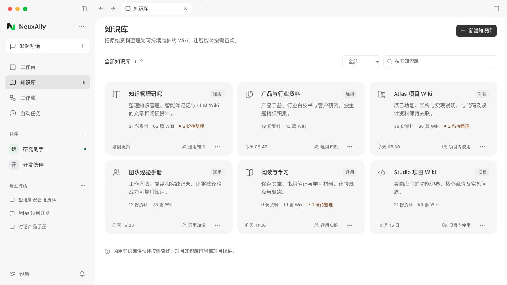

创建通用库时填写名称和用途。用途同时帮助智能体判断何时需要查询，创建阶段无需模型配置。

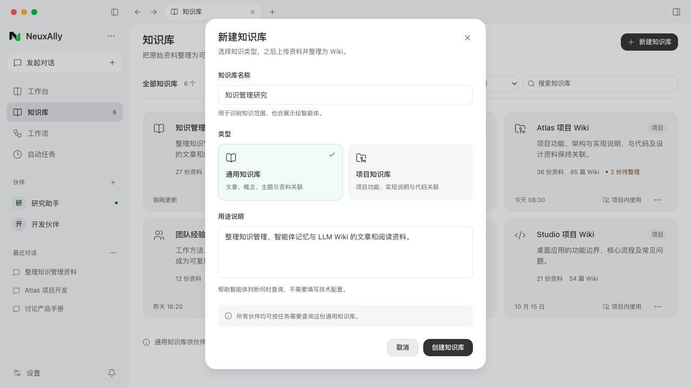

切换为项目类型后增加关联项目。不同伙伴中指向同一代码仓的相关项目可共用知识库，创建和关联的实际去重规则仍以规格为准。

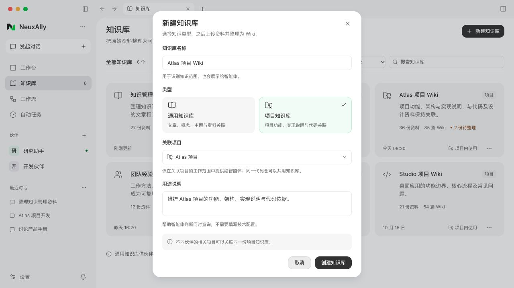

## 2. 上传原件与手动整理

原始资料页区分待整理、已整理和失败。顶部的“整理新增资料”面向增量范围；上传后的文件先进入待整理队列，已有 Wiki 仍可正常阅读。

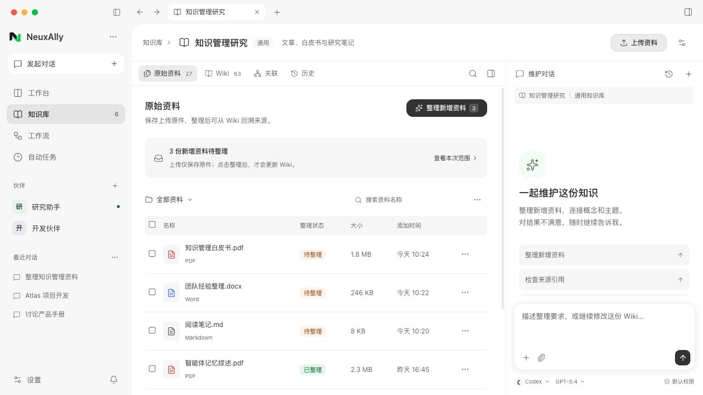

上传弹窗只负责保存原件。示例展示 PDF、现代 Word 文档和 Markdown；首版使用当前智能体已有能力读取原件，Wiki 统一为 Markdown；不新增固定的 PDF／Word 转 Markdown 流程。上传不等于原件已被智能体读取。

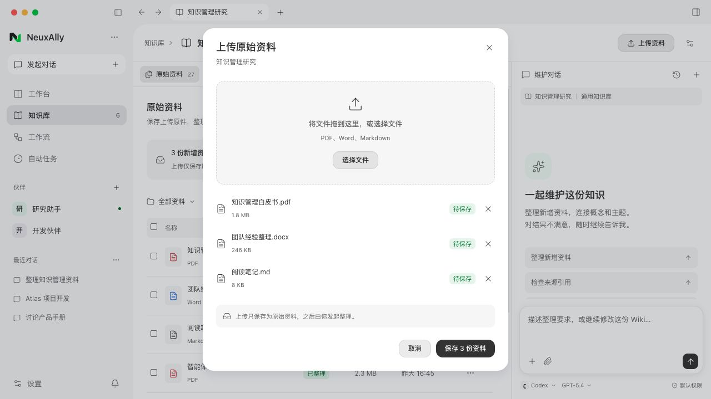

点击整理后，右侧出现本次资料范围。用户在同一输入区补充要求、选择智能体和模型，再发送整理任务。

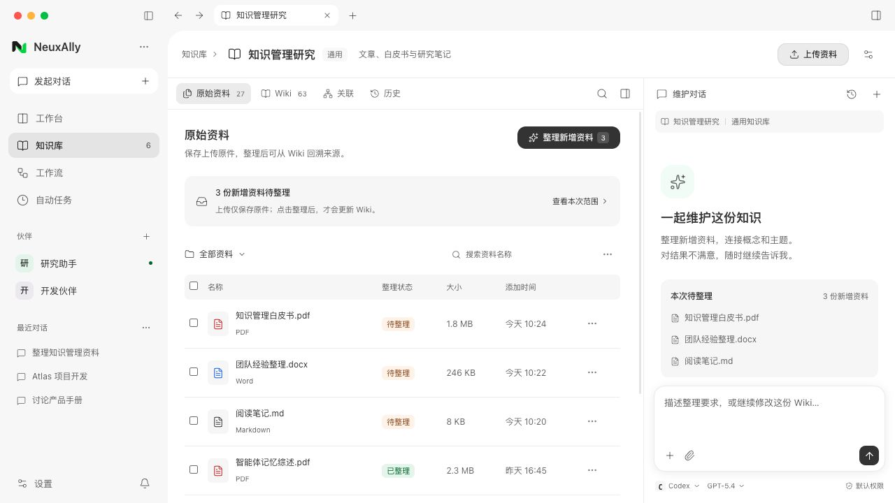

智能体选择放在维护对话的现有配置区域，不给知识库额外建立另一套执行设置。配置控件在原型中仅演示选择行为，真实实现需复用已有聊天配置能力。

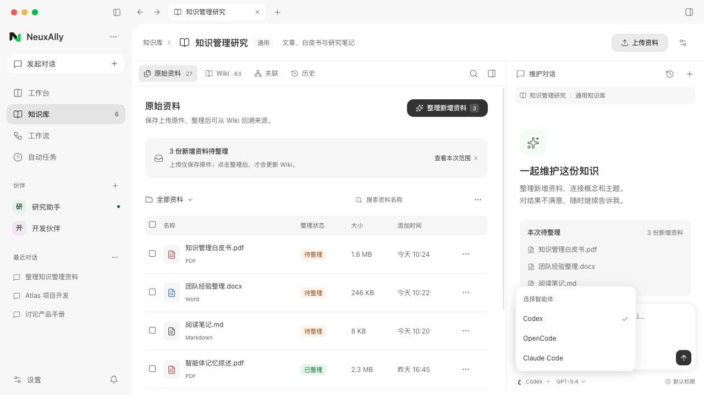

## 3. 整理与持续修订

右侧显示当前过程和停止入口，左侧保留原有 Wiki，避免正在整理时工作区变成整页加载。过程内容以真实执行为准，原型仅展示状态层级。

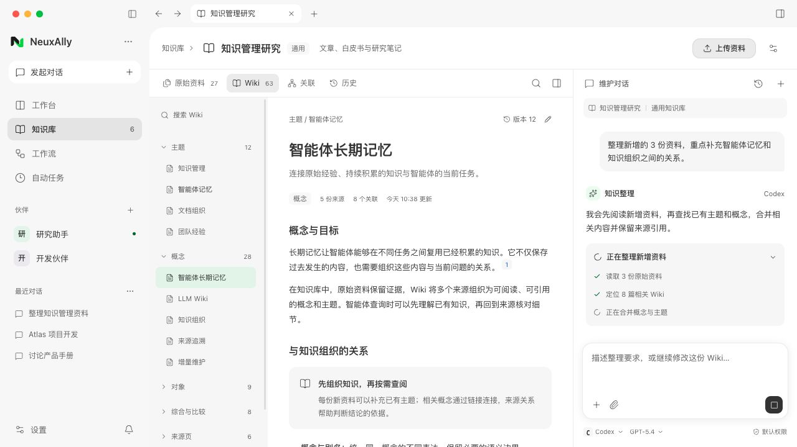

整理完成后，左侧按概念、主题、实体、综合说明等组织 Wiki。用户可以继续在右侧提出“合并概念”“补充引用”“重写这一节”等修改。每轮保存回执说明实际改变和版本；普通维护不强制再走一次独立审批。

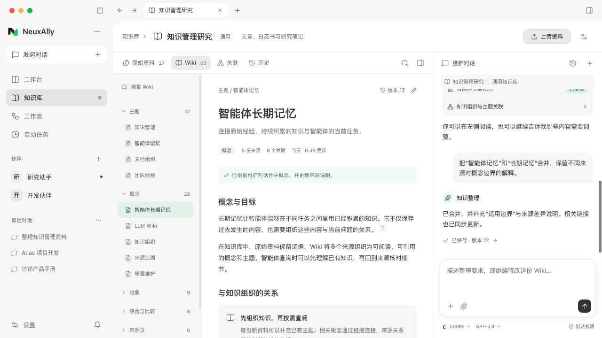

## 4. 阅读依据、关系与历史

点击 Wiki 引用进入来源阅读，在原件、定位信息和引用该资料的 Wiki 之间往返。图中的 PDF 页面是虚构排版，用于说明交互；真实 PDF、Word 和 Markdown 应分别使用对应的定位机制，不能把所有格式统一假定为页码。

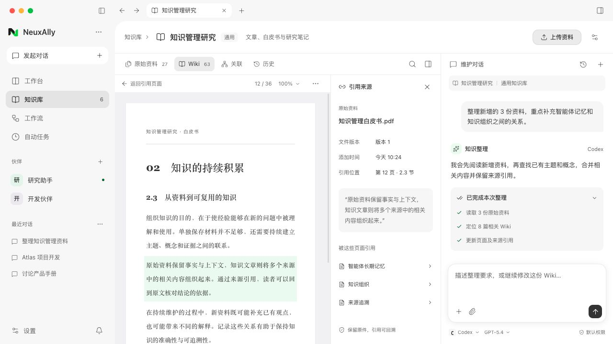

关系视图用于探索概念、主题与资料之间的连接。它是左侧的可选阅读方式，初始操作仍以目录和文章为主。

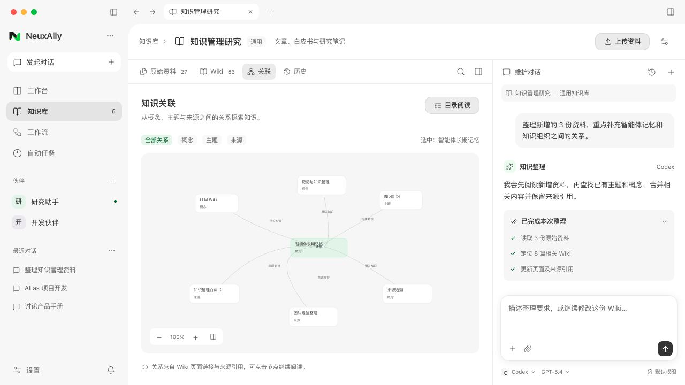

历史按维护轮次展示，左侧查看页面差异，并能定位对应维护对话。恢复版本属于写入操作，真实实现需要校验当前版本；原型只演示查看入口和差异阅读。

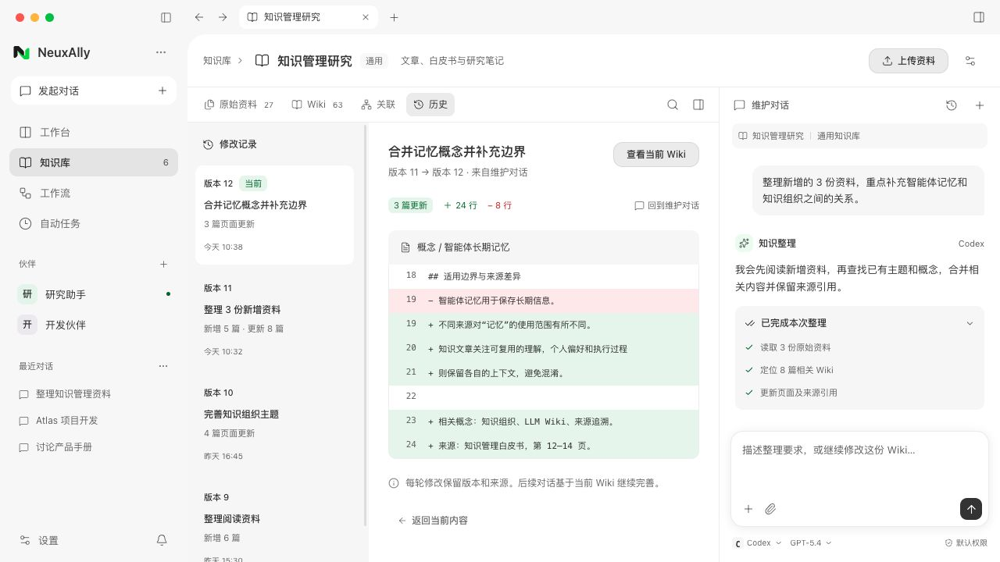

## 5. 项目关联与软件工程 Wiki

项目详情的知识库页说明当前关联、共用该知识库的相关项目，以及“仅在相关项目内使用”的范围。通用库在系统级管理，无需给伙伴逐个挂载。

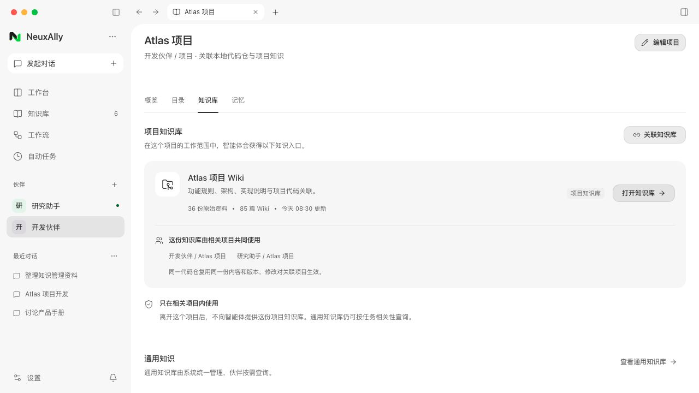

软件工程 Wiki 默认展示功能主题、实现说明、故障排查和术语表入口，并显示代码依据；通用文档 Wiki 以概念、主题及来源关联为中心。两者共用页面骨架，整理规则和内容结构分别设计。代码路径与行号在此为虚构示例。一级分类是对现有软件类 Wiki Demo 的呈现示例，仍需随本次知识库共同设计；具体页面由 Skill 按项目资料和代码维护，术语表是文件入口。前端接入时读取实际索引和页面元数据，图中的页面名与数量仅用于展示。详见规格第 7.1 节。

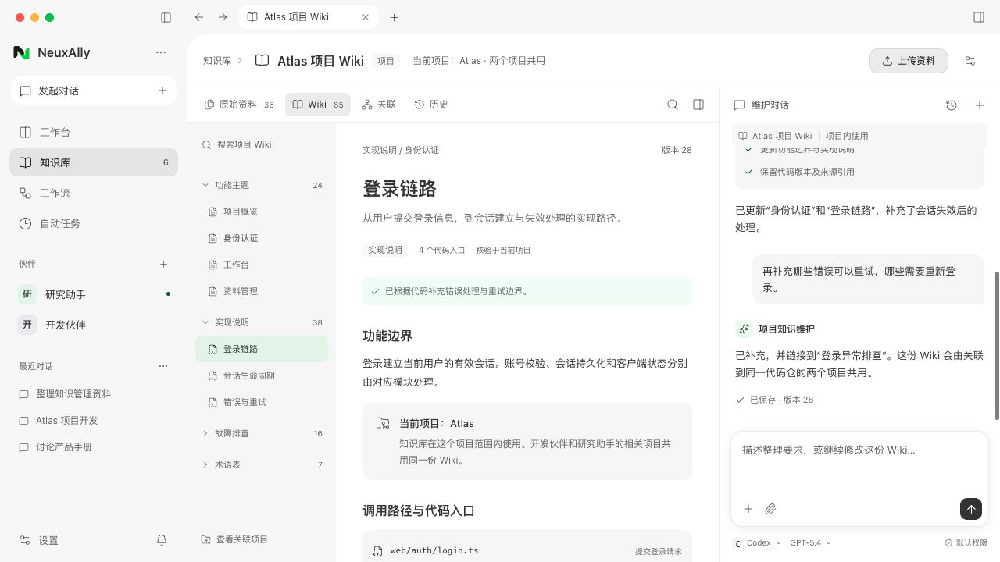

## 6. 普通聊天中的附件入库

用户明确要求将附件整理到某个知识库后，在原聊天显示两步回执：原始资料已保存、Wiki 已更新。沿用当前聊天智能体和模型，不要求用户重新打开知识库页面配置。结果提供知识库入口，后续修改可以继续留在原聊天。

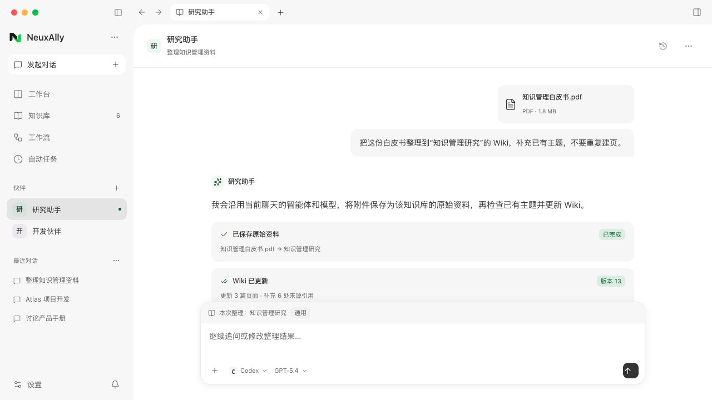

目标未明确时应先澄清；单纯上传、阅读或总结附件，不自动入库。此截图展示目标已经明确的成功路径。

## 7. 部分失败与暗色主题

部分失败需要同时展示已保存的成果、失败资料及原因。示例中的两份资料已经整理，一份解析失败；允许只重试失败资料，原件与已有 Wiki 保留。这里的失败示例不决定扫描 PDF 的最终支持边界。

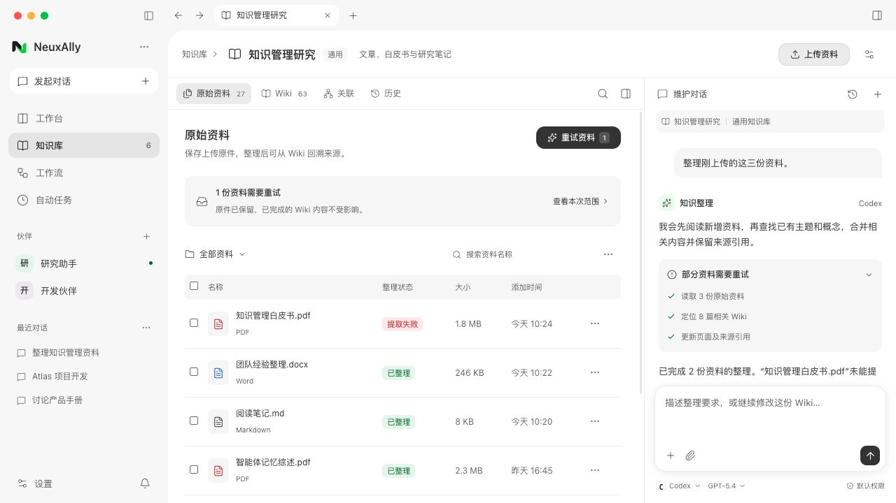

暗色布局保持相同的阅读和维护方式，直接使用仓库暗色语义颜色，不额外设计另一套主题。

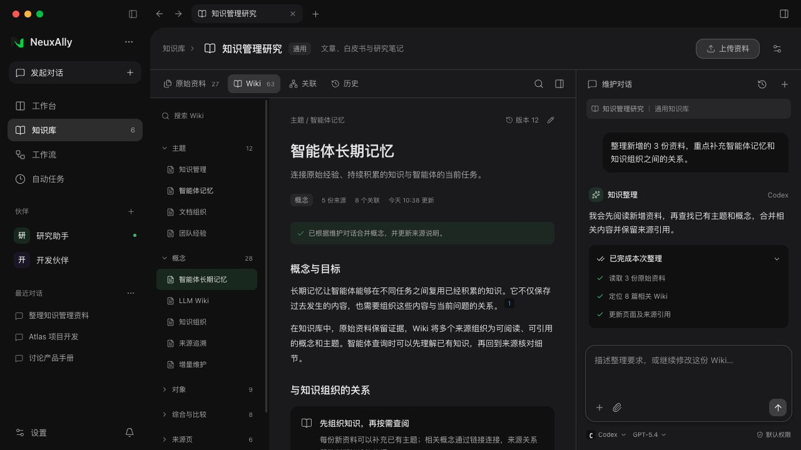

## 原型检查边界

已通过本地交互核对：列表搜索、创建类型切换、上传后待整理提示、智能体选择、整理过程进入 Wiki、右侧维护消息滚动、切换标签保留知识库身份和维护状态、只重试失败资料，以及普通聊天续改保留在原聊天。独立原型构建和文档检查不代表真实模型、解析、持久化、并发保存或桌面平台验收。

关系视图、历史呈现、菜单位置和示例目录属于待审前端提案；已确认的主题导航、可选现有定时任务、智能体读取原件和来源归档，以最新规格及详细设计为准。原型源文件与图片独立保存在本目录，未接入生产路由。
