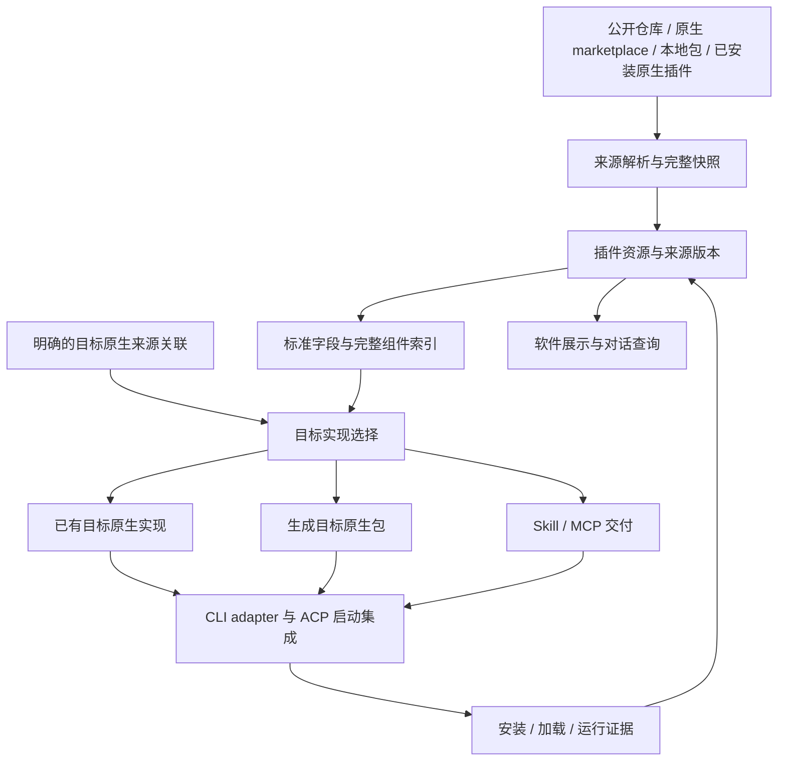

# 插件 v2 设计

> 状态：架构已确认，进入实施；完成情况按独立验收记录核对。
> 代码基线：`add253f53a0b455d103f3d8674c6f17fee030f74`。
> 行为、字段映射与验收要求以配套的 [插件 v2 Spec](2026-10-19-plugin-v2-spec.md) 为权威；本文解释意图、职责和实现边界。

## 1. 意图与已确认要求

用户安装和管理的是 `neuxally-plugin/` 中的统一插件入口。它可以只引用已经收集的 Codex、Claude 原生插件，也可以包含自己的能力实现；切换智能体时根据声明交付对应原生内容，没有对应原生实现时才使用本插件自己的内容。原生包分别收录在 `codex-plugins/`、`claude-plugins/`，保留原有格式与来源，不为收录再维护一套技能或工具实现。

已确认要求：

- 自有插件和统一入口采用 Codex 标准格式，主清单使用 `.codex-plugin/plugin.json`；第三方 Codex、Claude 及通用格式仍按原格式收录或导入，不建立新的插件清单标准。
- 源仓库区分 `codex-plugins/`、`claude-plugins/` 与 `neuxally-plugin/`；软件资源库默认展示统一入口，伙伴安装关系也绑定该入口。
- 可以为同一个资源声明不同 CLI 的已有原生插件来源；命中时优先交付已固定的原生包；下载通过 HTTP/API，安装归 NeuxAlly 管理。
- 保留用户导入或安装的完整原生包。转换只改写目标适配确有必要的部分，其余文件与组件继续交付。
- hooks、agents、commands、LSP 等由目标 CLI 执行，NeuxAlly 不因自身没有对应执行器而删除它们；实际加载或执行问题按具体组件反馈，再修正 adapter。
- 不具备原生插件加载能力的 CLI，使用其支持的 Skill 与 MCP 接入方式。
- 支持对话通过 allycli 安装到系统及当前伙伴；不直接写用户 Codex/Claude 全局插件环境。软件外原生插件的观察与导入仍保留原始内容。
- 说明优先使用所选插件版本的 README。详情页预览一部分，过长时通过“查看完整内容”打开 Markdown 阅读弹窗。
- 授权由插件或其 MCP 服务声明；NeuxAlly 提供通用二维码、链接和设备验证码交互，不为每个新插件增加提供者专用前后端分支。
- 插件目录查询与内容分发使用 Git 仓库和标准 marketplace 索引，不以建设插件市场服务器作为前提。
- 飞书办公缺少本项目收录的对应原生实现，归 `neuxally-plugin/feishu-office/` 的自有插件；其中复用的官方 CLI、技能与许可继续准确保留来源。

成功意味着来源可追溯、真实安装结果可核对、当前智能体实际加载正确的内容。包已下载、已安装、已加载和业务运行成功分别提供证据。

## 2. 当前代码与需要改变的边界

| 当前实现                                                                                                            | v2 变化                                                        |
| ------------------------------------------------------------------------------------------------------------------- | -------------------------------------------------------------- |
| [包解析](../../../server/internal/plugins/package.go) 已识别通用、Codex、Claude 三种清单                            | 保留现有格式入口，拆分格式解释与目标交付；保留全部原生组件描述 |
| [资源模型](../../../server/repositories/models/plugin.go) 已保存完整不可变内容、来源、伙伴安装和共享配置            | 复用这些事实，增加目标实现选择、原生安装关联和实际交付记录     |
| [执行接纳](../../../server/services/execution/plugins.go) 展开 Skill/MCP                                            | 增加原生插件交付路径；同一组件在两条路径之间只交付一次         |
| [Runtime 输入](../../../server/internal/runtimes/types.go) 只有 Skill/Connector，没有插件交付输入                   | 增加不依赖数据库的插件加载事实，并贯通 ACP adapter 到真实 CLI  |
| [插件源](../../../plugin-sources/README.md) 通过固定 bundle 随应用交付                                              | 公开仓库成为维护入口，继续支持固定快照和离线交付               |
| [allycli 操作目录](../../../server/internal/agentcapability/contract/catalog.go) 尚无插件安装                       | 提供发现、检查、安装、查询和卸载能力，与界面入口共享业务用例   |
| [展示解析](../../../server/internal/plugins/presentation.go) 已读取 README，但与图标共用 256 KiB 上限               | 说明正文独立按需读取；概要查询不携带所有完整正文               |
| [详情说明](../../../desktop/src/modules/plugin/components/plugin-overview.tsx) 直接展示正文，固定源生成说明可能优先 | 以当前解析版本 README 为正文，增加预览及完整阅读弹窗           |

当前能力说明仍由 [插件资源架构](../../architecture/plugin-resources-cn.md) 维护。v2 获准实施并验证后再更新当前架构文档，本轮不把目标行为写入已实现能力。

## 3. 从官方来源得到的设计依据

### 3.1 规范与仓库样例的关系

[OpenAI 打包文档](https://developers.openai.com/plugins/build/plugins) 支持 Agent Plugins 通用格式，并保留 `.codex-plugin/plugin.json` 兼容布局；[Claude Code 清单参考](https://code.claude.com/docs/en/plugins-reference) 定义 `.claude-plugin/plugin.json` 及原生组件的解释规则。两种格式的具体字段、目录和优先级见配套 Spec。

用户给出的 [openai/plugins](https://github.com/openai/plugins/tree/main/plugins) 是直接复用来源。本次读取的固定提交为 [`0722921d5542fc593105c27bd52630babd8b8c2a`](https://github.com/openai/plugins/tree/0722921d5542fc593105c27bd52630babd8b8c2a)，样例主要使用 Codex 兼容布局。不能因为最新文档推荐通用格式，就要求这些原生包先改成通用格式才能导入。

官方仓库的 [marketplace](https://github.com/openai/plugins/blob/0722921d5542fc593105c27bd52630babd8b8c2a/.agents/plugins/marketplace.json) 与 [API 登录 marketplace](https://github.com/openai/plugins/blob/0722921d5542fc593105c27bd52630babd8b8c2a/.agents/plugins/api_marketplace.json) 是不同目录来源。adapter 使用当前 CLI 和登录方式实际可用的目录，不能把目录项存在等同于当前账号可安装或可授权。

### 3.2 原生内容不止 Skill 与 MCP

本次读取了 Figma 的 [清单](https://github.com/openai/plugins/blob/0722921d5542fc593105c27bd52630babd8b8c2a/plugins/figma/.codex-plugin/plugin.json)、[README](https://github.com/openai/plugins/blob/0722921d5542fc593105c27bd52630babd8b8c2a/plugins/figma/README.md)、`.app.json`、`.mcp.json` 及许可；也读取了 GitHub 的清单与 MCP 定义。样例包含技能、脚本、agents、commands、hooks、资产及托管连接资料，证明完整原包需要保留。

标准 MCP 服务定义与 OpenAI 的托管连接 ID 是两种依赖。托管连接 ID 不能凭字符串转换成为 Claude Code 的认证或 MCP 地址。可以优先使用声明的 CC 原生实现，或者使用包内真实存在、目标可解释的 MCP 定义；仍未满足的连接依赖必须如实报告。

Figma 样例声明专有的 Developer Terms，其他插件可能使用 MIT 或另外的许可。复用时记录和保留逐插件、逐组件的实际声明；目录维护者、包作者、服务提供方和 NeuxAlly 的适配维护者分别记录。公开可读本身不作为统一再分发许可。

## 4. 总体结构

以下是目标职责示意图，箭头表示内容解析或交付关系，不表示所有步骤都需要下载。

原始快照、用于查询的组件索引、目标交付物分别存在。索引是派生数据，不能取代原包；目标产物可重建，不能拥有独立的伙伴安装开关。一个资源可以在不同 CLI 下使用不同来源实现，详情与执行快照必须显示实际使用的那份来源和版本。

统一入口的安装身份与实际交付身份分别记录。例如用户安装 `neuxally-plugin/github` 后只建立一份伙伴安装关系；Codex 执行可使用 `codex-plugins/github`，Claude 执行可使用 `claude-plugins/github`。这一步由 NeuxAlly 的解析与安装用例完成，不要求原生 CLI 理解 NeuxAlly 引用文件，也不先向 CLI 安装一个空壳再期望它自行跳转。

## 5. 公开插件仓库与第三方复用

公开源码维护仓库为 [JieWaZi/NeuAally-Plugins](https://github.com/JieWaZi/NeuAally-Plugins)。仓库从现有独立 Git bundle 恢复飞书和 GitHub 包及来源历史，README 指明 OpenAI 参考来源，逐包保留上游、许可与补丁。v1 内容作为实现基线，v2 按下述职责重组；实际加载、授权与在线分发分别验证。

v2 目标目录按三类组织，具体示例及索引规则见 Spec。`codex-plugins/`、`claude-plugins/` 保存收集的原生包，包内原生清单、组件、README 和许可不为适应本软件重写。`neuxally-plugin/` 保存统一安装入口和自有实现，使用 Codex 标准 `.codex-plugin/plugin.json`、可选 `skills/`、`.mcp.json` 及其他原生组件；本软件专属引用与授权接入保存在 `.neuxally/`。收录和自有实现都由公开仓库维护，不将安装 ZIP 放入应用发行包。

第三方原生内容按来源快照整理到对应目录，并保留上游仓库或 marketplace 定位。OpenAI 已有包直接收集原内容，不为统一入口再封装一套技能或认证程序。确需修改时记录上游提交、补丁与维护者；实际随应用分发的第三方内容同步进入 [第三方声明](../../../THIRD_PARTY_NOTICES.md)。统一入口的维护者与原生包作者分别记录，不能将收录等同于自行实现。

可选的跨 CLI 原生来源关联与授权入口放在 `.neuxally/integration.json`，需要的授权桥接放在 `.neuxally/auth/`；第三方资源无需补文件，其附加关联由 Core 登记。附加文件不重复保存插件名称、版本、作者、技能和 MCP 定义，也不取代官方的 `com.openai` 等平台扩展。原生来源关联可以保留既有 marketplace 的定位；客户端通过 HTTP/API 获取固定的收录包，由 adapter 生成受管会话输入。确切规则见 Spec。

### 5.1 Git 仓库维护与 HTTP 查询分发

Core 维护可配置的来源列表，默认包含本项目公开仓库，并可以收录 OpenAI 或 CC 的原生 marketplace。来源列表属于应用配置；来源目录本身继续使用已有 `.agents/plugins/marketplace.json` 或 `.claude-plugin/marketplace.json`，标准索引用于原生生态，应用使用公开 Release 生成的 HTTP 目录描述，二者不是插件清单本身。

软件默认目录只查询 `neuxally-plugin/` 的统一入口；原生收集目录用于解析、来源查看与显式原生导入，不能把 GitHub 的两个原生包与统一入口显示成三个默认插件。软件 HTTP 目录与原生标准索引分别发布，不能把只含引用的入口直接当作具有实际能力的 CLI 插件发布。

查询通过 HTTP 读取目录描述，取得来源提交、包下载 URL、摘要与标准清单展示摘要，缓存为本地可搜索目录。列表、搜索、筛选、分页和准确总数读取该缓存，不要求用户安装 git，也不在每次输入时访问远程。缓存记录来源提交与新鲜度，网络失败保留旧结果；首次同步未知不表示没有插件。

目录存在、当前目标可以安装、目标组合已验证是不同事实。收录 OpenAI 目录不表示宣称其全部插件已经支持 NeuxAlly；需要结合本机 CLI、授权方式、原生关联与已记录验证证据回答“哪些可用”。具体查询语义见 Spec。

安装按选定目录描述固定来源提交、包根、URL 和 SHA-256；Core 通过 HTTP 下载完整归档，核对摘要与相对路径后存入不可变来源根，再解析原生引用并准备受管目标产物。大型二进制可通过带摘要的发布资产分发，不提交到 Git 内容树。

刷新由安装需要、启动后的有界同步和用户主动刷新触发，不新增永久扫描。远端目录提交更新只改变可发现目录；已有伙伴和执行的固定内容不被自动替换。此方案需要客户端缓存、解析和下载能力，不需要单独运行在线市场查询服务；它不承担账号授权、凭据或动态授权会话。

## 6. 事实、身份与版本

| 对象         | 拥有的事实                                                            |
| ------------ | --------------------------------------------------------------------- |
| 插件资源     | 稳定本机身份、归属、用户展示别名；复用 `Plugin`                       |
| 来源版本     | 完整原包、清单、README、来源证据与内容摘要；复用 `PluginVersion`      |
| 伙伴安装     | 当前伙伴启用哪个资源版本；复用 `WakerPlugin`                          |
| 共享配置     | 现有配置修订、密钥和提供者授权；复用 `PluginConfiguration` 及授权模块 |
| 目标来源关联 | 哪个 CLI 可用哪个 marketplace 原生插件；有来源、维护者及修订          |
| 目标解析结果 | 实际选择的来源包、真实版本与摘要、adapter 版本、交付模式              |
| 原生安装关联 | CLI 配置身份、安装作用域、原生插件 ID、路径、所有权及最近观察证据     |
| 执行快照     | 本轮实际交付的目标解析结果、配置修订、组件身份与加载证据              |

新增记录继续归插件领域管理，不建立第二份资源或账号事实。最小持久化结构由实现者选择，但必须满足 Spec 的唯一性和恢复要求。

资源去重沿用明确来源身份；展示名、清单里的 `repository` 声明或相似能力不能证明两个插件相同。不同原生实现只有存在明确关联时才归入同一个资源。临时会话 ID、随机端口和凭据不参与稳定业务身份。

伙伴固定的资源版本和目标解析结果分别固定。切换到另一个 CLI 可以首次解析其原生实现，但同一资源版本、同一目标后续复用已解析结果；marketplace 刷新不会偷偷切换已经固定的目标内容。重试恢复原解析快照，不能临时改用另一来源或新版内容。

## 7. 目标实现选择与 adapter

目标选择顺序以 Spec 为权威：读取已经安装的统一入口；存在当前目标的明确原生引用时交付该原生包；没有该引用时使用本插件自己的能力。自有内容在 Codex 中直接原生加载，在 Claude 中由 adapter 转为 CC 原生包；其他没有原生插件接入能力的目标交付其支持的 Skill/MCP。既无当前目标引用又无自有能力时准确报告该目标无实现，不把纯引用入口当作可用能力。

飞书办公按自有插件处理，不先维护两份“Codex 飞书”和“Claude 飞书”。其来源身份保持同一插件，CC 转换产物仅是派生交付物。底层官方 CLI 和技能的作者、许可、版本及修改记录继续独立保留。

adapter 由两部分组成：

- 来源格式解释：读取原生规则、组件声明和默认目录，形成可查询索引，保留未知字段与文件。
- 目标交付：探测当前 CLI 与集成链路、解释原生安装回执、转换必要字段、准备加载输入及核对结果。

通用层负责来源、内容、关联、选择和状态；不实现 hook 执行器、agent 调度器、command 解释器或 LSP 客户端。这些组件交给原生 CLI。目标字段转换保持结构化，文件复制保留相对引用及执行位。

Runtime 仍不读取插件数据库。Execution 接纳时冻结目标解析与允许交付范围，再把原生插件目录、原生身份、配置引用或 Skill/MCP 交付输入传给 Runtime。ACP 依赖没有相应传递能力时，需要同步扩展依赖端口并定向验证；不能用 CLI 手工启动成功替代应用内加载成功。

## 8. 对话安装、受管交付与结果登记

界面和 allycli 是两个真实生产入口，应把共享安装业务从当前 API 内编排提取到插件领域 Service，遵守 [后端约定](../../development/backend-cn.md)。网络、CLI、授权等待和文件操作均在数据库事务外执行。客户端安装链路不执行 Git 命令。

受管对话安装由 agent 选择来源并调用 allycli；HTTP 界面与 allycli 复用同一安装用例，完成来源获取、摘要核对、系统登记和当前伙伴关联。目标加载时使用应用拥有的原生目录与会话配置，不把“安装插件”翻译为用户 Codex 或 Claude 全局安装命令。用户主动在软件外安装的原生包可以只读观察或导入，不能据此自动向全部伙伴授权。

安装写入使用现有 request-id 与内容摘要幂等机制。处理流程保存可恢复的阶段与外部回执：下载内容、受管产物发布和数据库登记不能跨系统原子提交，因此响应不确定时按同一请求和内容摘要核对，不生成重复关系或下载。取消和部分失败不删除用户已有插件。

需要用户连接账号或满足原生信任策略时，复用现有授权和交互入口。收到明确安装请求后，不为普通下载、格式转换、重复检测增加新的确认步骤。跨 CLI 使用不要求重复安装；不同实现确实需要不同账号授权时保留真实授权边界。

## 9. 原生组件保留与故障处理

Spec 逐组件定义交付原则。安装包含源包完整内容，hooks、agents、commands、LSP 与未知组件不受 NeuxAlly 组件白名单裁剪。目标原生清单可以直接引用的内容保持原样；必须转换的变量、路径和结构只在派生产物改写。

不同 CLI 的 hook 事件和输入输出协议未必等价。adapter 只对有依据的语义做映射；其他内容继续保留并交给相应原生清单使用，不编造事件对应关系。实际目标忽略、拒绝加载或执行失败时，记录目标、组件与原因，不把保留文件描述为已验证运行。

原生路径不能绕过现有 Execution 的目录、连接器白名单和授权范围。若目标 CLI 无法表达本次受限范围，应拒绝该交付或明确采用用户允许的能力子集，不能通过完整原生包暗中加载额外连接器或 hook。未知组件未经理解时，在不能隔离能力的受限入口中不交付整包；普通已授权原生场景仍按目标 CLI 行为执行。

已有原生安装失败时，不自动更换来源、偷偷降级或者删除用户原安装。只有“目标无原生插件接入能力”才自动走 Skill/MCP 路径；已支持原生却被策略拒绝与加载失败分别报告。

## 10. 授权、会话与清理

### 10.1 声明式授权与通用前端

授权策略优先来自标准 MCP 服务的挑战与 OAuth 元数据、原生 CLI 的授权机制及 OpenAI/CC 已有认证声明。OpenAI 的 MCP 认证设置位于服务级 `extensions.com.openai.auth`，不能误读为插件根清单的同名设置；CC 的 OAuth 字段也由对应 adapter 解释。相关官方依据见 Spec。

通用授权层只实现有限的协议策略：MCP OAuth、原生 CLI 委托、标准设备授权，以及插件自带桥接。一个新插件采用已支持策略时，不修改提供者枚举、Core 分支或前端页面。插件负责声明身份服务、scope、入口和必要配置，运行时再产生本次授权链接、验证码、二维码内容与到期事实。

前端消费统一授权会话和动作描述，渲染二维码、外链、验证码、等待、刷新、取消及结果；它不判断 `provider == github/feishu` 来选择界面。Core 拥有会话、互斥、期限、取消、秘密保护和提交后事件，不解析任意终端自然语言来猜授权成功。

标准 MCP OAuth 不能覆盖任意 CLI 私有扫码流程。此时由插件在 `.neuxally/integration.json` 声明统一桥接协议与入口，桥接内容位于 `.neuxally/auth/`；供应商特有命令、响应解析和多阶段授权归插件仓库维护。桥接协议是 NeuxAlly 可选交互扩展，不冒充 OpenAI/CC 的清单标准，也不要求标准 MCP 插件实现它。桥接事件、身份交付和终态核对见 Spec。

二维码是展示方式，不是授权协议。设备授权可根据服务器的 `verification_uri_complete` 显示二维码；具有本机 loopback 回调的浏览器授权链接不能自动转为手机扫码入口。只有真实流程允许跨设备授权时才提供该动作。多阶段扫码由同一会话的连续挑战表达，不为“创建应用后再授权”等流程增加前端特例。

### 10.2 既有授权模块的演进

现有飞书与 GitHub 的提供者实现属于 v1 基线。v2 实施应将其供应商专用流程包装到插件侧桥接，Core 保留并复用共享配置、身份互斥、占用、取消和生命周期机制。现有隔离 profile、钥匙串隔离与凭据作用域约束不能因移动实现位置失效。

供应商专用流程与依赖资产归插件仓库维护，宿主不为每个服务商维护下载或交互分支。标准 OAuth 客户端和通用桥接属于 v2 宿主能力，不扩展为自建身份服务器或代替所有第三方的 OAuth 应用注册。

### 10.3 凭据、会话与引用

共享配置、提供者身份占用及最后引用清理继续复用现有模块。原生实现的认证只在明确共享同一提供者与账号范围时复用；OpenAI 托管连接身份不等同于 NeuxAlly 的共享账号。

目标产物不固化用户 token。原生加载所需密钥由对应账号或执行时注入提供，授权值不进入普通回执、README、模型指令或执行快照。第三方清单中的认证配置按原生语义保留，不把认证端点或 OAuth 声明推断为已经授权。

插件版本、目标实现、配置和可交付组件集合参与现有会话作用域指纹。安装过程中不改写正在运行的内容；支持重载时在明确边界重载，否则下一轮执行前按现有聊天续接规则重建原生会话。恢复只提交新增消息，避免重复注入完整历史。

卸载区分伙伴关系、NeuxAlly 拥有的目标安装、外部安装和内容快照。只清理由本应用拥有且无剩余引用或执行占用的产物；外部观察记录的删除不调用原生卸载。用户明确请求卸载其原生安装时，作用域必须被准确识别。同一原生安装为多个伙伴服务时，单个伙伴卸载不能移除它。

## 11. README 展示

所有插件详情共用说明预览与完整阅读弹窗。当前页面所选来源版本的 README 是正文依据；列表简介继续使用标准短描述。README 不存在时再回退长描述或普通 description。固定源生成资料不能覆盖不同摘要版本的原文。

预览与弹窗的正文版本一致。预览在布局上限制高度，不能先切断 Markdown 源码；仅真实溢出时展示“查看完整内容”。弹窗按需读取完整正文，复用 `DialogContent` 和 `MarkdownContent`，保留标题、内部滚动、关闭、键盘及焦点恢复。

相对文档链接按固定来源版本解释；本机访问继续经受管文件范围校验。原始 HTML、脚本和远程图片遵守 [前端 Markdown 约定](../../development/frontend-cn.md)，不因说明来自官方仓库放宽。跨 CLI 对应实现具有不同 README 时，展示其真实来源，不能把一个实现的说明冒充另一个实现的运行承诺。

UI 的尺寸、排版、容器响应和阅读限制在 Spec 中集中定义。本轮不生成或打开运行中的页面。

## 12. 实施与验收边界

本轮实现公开插件仓库与 NeuxAlly 双仓库解耦，覆盖原生导入展示、HTTP 目录查询和下载、allycli 系统安装、目标原生加载或 Skill/MCP 投影、声明驱动授权和 README 阅读。仓库 README 必须给出使用、开发、收录及授权接入步骤，含整体架构图和授权时序图。

插件仓库维护标准包与专用桥接；NeuxAlly 管理来源快照、伙伴关系、通用协议和界面。无需新建在线市场后台、自建 OAuth 身份服务器、通用依赖管理器或自有 hook/agent/LSP 执行环境。

## 13. 作者提出的默认选择

实施采用以下默认选择；准确行为和接口通过配套 Spec 及生成契约核对：

1. 自有插件集中在已建立的公开仓库，各插件独立版本；第三方已有实现优先保持来源引用。
2. 通过 NeuxAlly 对话发起的默认安装关联当前伙伴，目标文件写入应用受管范围；默认交付始终使用应用拥有的原生会话目录；不扩大到用户全局插件注册表。
3. 自有包与统一入口使用 Codex 标准主体，NeuxAlly 专属来源关联与授权入口放在 `.neuxally/` 附加目录；外部包无需修改，其关联保存在 Core 登记中。引用型入口的具体信息与路由在 Spec 中定义。
4. README 预览采用约十二行正文的高度预算；完整 Markdown 内置阅读上限独立为 1 MiB，超限保持原文件并提供原始内容入口，不静默截断。
5. 已解析的目标内容固定，目录刷新不自动切换既有安装；本轮不额外设计用户版本升级界面。
6. 优先标准 OAuth 和原生授权；非标准流程通过插件自带桥接扩展统一交互。桥接协议和目录缓存随本轮实施，真实账号业务运行需要独立证据。

## 14. 后续验收与文档关系

字段解释、来源选择、转换规则和验收场景只在 [配套 Spec](2026-10-19-plugin-v2-spec.md) 定义。实施安排见 [执行计划](../plans/2026-10-19-plugin-v2.md)。自动化、原生加载及真实账号业务运行分别报告结果，不能互相替代。
