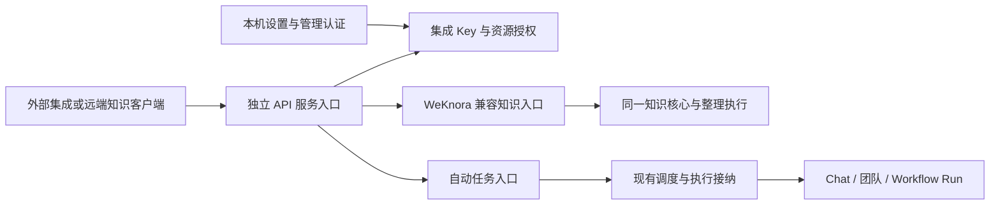
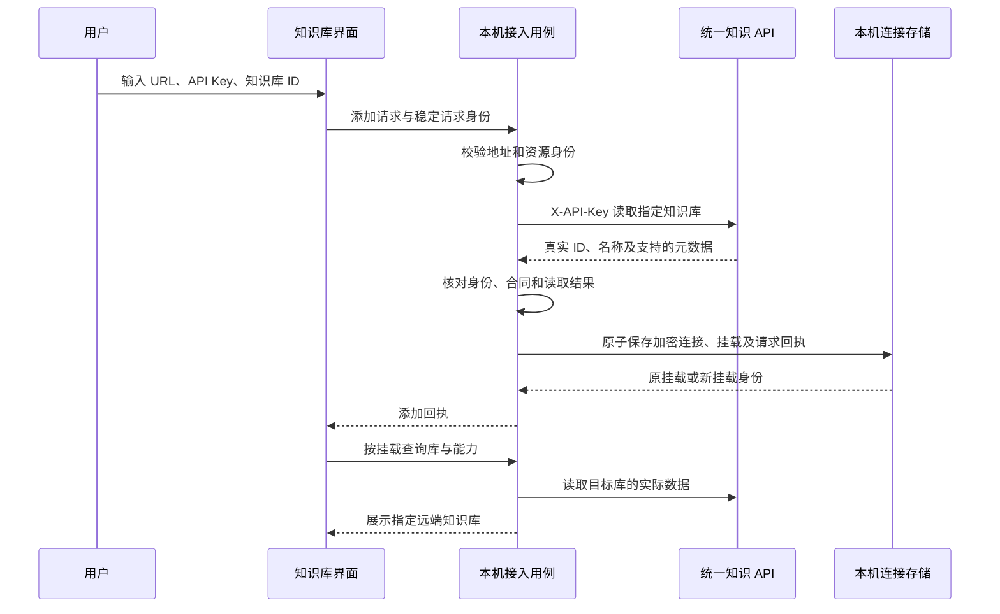

# API 集成、远端知识库与自动任务复用设计

> 本文是待实施设计。本轮只编写文档，不修改产品代码、生成协议、运行配置或真实授权。当前能力以[知识核心与宿主接入](../../architecture/knowledge-cn.md)和[自动任务与 IM](../../architecture/automation-and-im-cn.md)为准。

## 1. 已确认范围与设计目标

用户已确认：

- 设置新增“发布集成”分组，二级入口为“API 集成”。API 集成为应用级能力，同时服务知识库与自动任务。
- 添加远端知识库只需要远程 URL、API Key 和知识库 ID；验证成功后挂载指定知识库。
- 首版知识 API 包含读取、检索、内容写入和整理，写入与整理分别授权。
- NeuxAlly 发布的远端知识服务与 WeKnora 保持同一套对外接入设计，用户和知识客户端不需要区分提供者。
- 优先直接迁移和复用 WeKnora 已有代码与测试，不为 API Key、权限或知识接口重新编写一套相似实现。
- 自动任务复用统一的 Key、权限及对外入口，同时继续使用现有调度、执行与结果能力。

设计目标是让一个外部集成持有独立 API Key，按授予的操作与资源范围调用服务。例如，同一个 Key 可以读取和整理选定的资料库甲、乙，并触发自动任务丙，不能因此访问其他知识库、伙伴、账号或任务。

本设计选择：采用服务间 API Key 身份；首版不增加完整多租户体系、终端用户 JWT、WeKnora 聊天产品、公开浏览器直连或动态通配资源授权。本文中的默认值、结果隔离及迁移策略为设计建议，不视为已经实现的能力。

## 2. 同一套对外知识协议

### 2.1 统一到协议层

“不区分远端”同时覆盖表单、认证、资源身份和 HTTP 合同。新接入不出现“NeuxAlly／WeKnora”、`custom`、`bearer` 等必选项，不依赖探测提供者后切换两套路由。

NeuxAlly 对外提供 WeKnora 兼容的知识 API。统一知识客户端对两种部署使用相同的认证头、知识库路径、字段、响应包装、分页及错误语义；NeuxAlly 内部再转换到现有知识核心和宿主执行。不能仅统一界面，再让外部调用者分别实现自有协议和 WeKnora 协议。

| 合同部分 | 对外约定 |
| --- | --- |
| 地址 | 设置页提供完整 API 基地址，包含 `/api/v1`；接入端也接受部署根地址 |
| 凭据 | `X-API-Key`；新知识接入使用资源范围已确定的 Key，无需再填空间 ID、登录 JWT 或平台管理 Key |
| 资源身份 | 使用远端实际知识库 ID；名称和本机连接 ID 不能替代它 |
| 基础读取 | 按已核对的 `/api/v1/knowledge-bases/{id}` 等 WeKnora 合同访问 |
| Wiki | 保留上游 `/api/v1/knowledgebase/{kb_id}/wiki/...` 的实际命名及响应差异，不自行改成另一套路由 |
| 操作结果 | 按对应上游接口区分响应包装、接纳、执行中和完成，不能把所有响应强行包装成一种成功实体 |
| 能力差异 | 按协议版本、操作支持、实际授权和配置条件表达；不按产品名称判断 |

兼容基线沿用[WeKnora 代码比对](../../discussions/knowledge-weknora-code-comparison-cn.md)固定的 WeKnora 提交；HTTP 参考见[协议核对记录](../../discussions/weknora-local-8080-reference.md)。实施前逐操作核对该基线与目标实例差异，不能把同名接口当作语义已经兼容。

### 2.2 兼容范围与现有差距

目标兼容范围包括库详情、资料与原件、Wiki、目录、图谱、检索、内容写入，以及整理的提交和状态读取。完整路径及 Schema 以最终核对后的生成合同维护，本文不复制另一份全量接口表。

首版必须核对并打通读取、检索、资料上传、普通 Wiki 内容编辑、指定来源整理的提交与状态读取；不能把这些操作长期标成“未验证”，再把仅能读取的版本视为本设计完成。条件写、重建、永久清理及未知结果自动恢复等增强能力另按实际合同判断。上游版本缺少必需合同或存在无法保持的安全语义时，属于实施前的明确阻塞项，须补齐迁移或重新讨论该项范围，不暗中缩减交付。

当前 WeKnora 客户端主要验证了读取；自有远端的 `/api/knowledge/v1`、Bearer、执行 profile 和回执是另一套存量合同。新设计需要补充服务端兼容入口及客户端写入合同，不能只给现有连接表单增加知识库 ID 就宣称完成统一。

WeKnora 尚无对应合同、当前版本未验证或不能保持必要安全语义的操作，返回明确的能力限制。公共功能不新增提供者专属必填字段；确需扩展的能力通过可协商的操作能力表达，并与基础兼容范围分开验收。整理在服务端解析执行配置，新知识客户端不必填写 NeuxAlly 的 `profileId`。

现有[统一操作适配设计](2026-10-21-knowledge-adapters-design.md)继续约束 UI 与领域操作隔离、完整资源引用和禁止本地回退；其中 `custom`／官方协议分支只描述存量适配。新建远端连接与对外发布合同以本文的统一协议为目标。

自动任务是 NeuxAlly 在同一 API 服务上的资源扩展，不表示 WeKnora 自动具备自动任务接口，也不影响知识客户端对两种知识服务使用同一合同。

### 2.3 直接迁移与复用边界

WeKnora 同版本源码是实现基础，兼容适配不是重新实现上游业务的理由。实施者先形成可复用代码及测试清单，核对依赖后迁移；只有上游没有对应能力，或与本机架构存在具体冲突时才新增适配，并说明必要性。不得先写一套通用 Key 管理器、权限框架或知识服务，再仅在外部包装成相似接口。

| 部分 | 优先复用的现成实现 | 必要适配 |
| --- | --- | --- |
| API Key 生命周期 | 上游 Key 模型、创建与更新校验、权限配置、到期／撤销规则及测试 | 本机管理认证、SQLite、凭据摘要与既有事务规范；不引入完整空间成员体系 |
| 权限与资源范围 | 上游能力定义、授权校验、中间件、库范围过滤及越权测试 | 宿主项目范围与撤权发布屏障，增加自动任务资源映射；不并行维护两份权限判断 |
| 知识 HTTP | 已核对的 handler、请求响应类型、路由、分页及合同测试 | 连接现有知识核心与宿主用例，适配数据库和稳定错误，不改变公共合同 |
| 知识业务 | 已迁入独立核心的算法、内容写入、来源、目录、版本与整理能力 | 继续复用现有实现；发现缺口先核对上游，避免重复迁入或另写近似逻辑 |
| 整理执行 | 上游整理请求、配置语义、状态与对应测试，现有 NeuxAlly 整理执行 | 在服务端绑定 Chat／Execution／Runtime，保留真实终态与发布授权检查 |
| 设置与接入交互 | 上游 API Key 表单的字段关系、校验和授权交互 | 在 React 中复用当前共享控件表达，不为了复制 Vue 组件引入第二套前端体系 |
| 自动任务 | NeuxAlly 已有上传、幂等接纳、调度、执行、结果及文件用例 | 接入同一 Key 和资源授权，补充主体隔离；不迁入第二套调度器 |

优先保留上游已有能力标识和校验机制，本文业务权限表用于描述用户可授予的操作；差异集中于明确适配处。资源范围空值、整理与直接编辑的权限分离、摘要存储及发布撤权等安全差异必须有显式转换和回归测试，不能因直接复用而静默放宽，也不能在每个入口重新判断。

每项迁入记录固定上游提交、原文件路径、许可、迁入位置、必要修改及保留测试。已经位于独立核心的实现只使用现有公开边界；核心变更仍从其源仓库经同步生成器交付，宿主不再复制一份。第三方来源统一维护到现有上游清单和第三方说明。

## 3. 设置入口与职责归属

设置保留唯一 Settings Scene，在“发布集成 → API 集成”提供三组内容：

1. API 服务：启用状态、监听地址和端口、实际可用状态、可复制的 API 基地址。区分监听地址与供客户端使用的访问地址，`0.0.0.0` 不直接作为可复制 URL。
2. API 文档：当前发布能力的文档、认证及请求示例，显示实际支持范围。
3. API Keys：名称、操作能力、资源范围、有效期、状态、创建时间和最近使用时间；支持创建、修改授权、停用、轮换与撤销。

创建 Key 时分别选择知识库范围及能力、自动任务范围及能力。界面只展示中文业务名称，不要求用户理解内部权限码。同一类型下，Key 的能力集合应用于所有选定资源，沿用上游“能力集合 × 库范围”的模型；需要不同库具有不同权限时创建独立 Key，不额外实现逐库权限矩阵。知识库与自动任务两类授权分别保存。

管理 API Key、修改监听和发布配置仅允许本机管理身份操作，不向普通集成 Key 开放。添加远端知识库仍位于知识库入口，它保存的是本机调用外部服务所需的连接，不与本机颁发 Key 的列表混用。

示意图只表示职责。Gateway 是路由与共享认证边界，不额外创建转发用的 Service、第二套知识库、执行状态或调度器。

## 4. API Key 权限模型

### 4.1 身份、资源与授权

| 概念 | 职责与不变量 |
| --- | --- |
| Key ID | 稳定调用主体；轮换凭据不改变主体，便于审计和查询既有运行 |
| Key 凭据 | 高熵秘密，只用于认证；与 Key ID、资源 ID 分开 |
| 凭据代次 | 轮换时递增，旧凭据立即失效；不能通过恢复旧请求继续授权 |
| 授权版本 | 能力、资源范围、有效期或状态变化时更新，供接纳与发布重新检查 |
| 资源授权组 | 每种资源类型一组，保存明确 ID 集合及统一操作集合；不包含客户端提交的任意目录或账号 |
| 本机远端连接 | 目标服务地址与加密凭据，不是该服务的授权权威 |
| 本机远端挂载 | 连接 ID 与实际知识库 ID 的绑定，只表示用户已添加哪个库 |

授权结果为：凭据有效，并且该资源类型、实际资源 ID、请求操作全部命中有效授权；写入还需满足来源限制、库当前策略、对象版本和执行条件。身份或任何必要条件缺失时拒绝。

资源范围为空表示无授权。提供“选择全部当前资源”时，保存当时展开的明确 ID；后续新建资源不会自动加入。服务端过滤列表、计数及分页，不能先返回全部资源再交给前端隐藏。借助文件、页面、任务或运行 ID 访问时，也必须验证它确实属于获准资源。

### 4.2 首版操作划分

下表中的操作名是本机统一授权语义，不自行冒充 WeKnora 的实际权限字段。兼容边界按上游字段和各路由的真实鉴权规则映射。

| 操作 | 知识库或任务范围内的能力 | 边界 |
| --- | --- | --- |
| 知识库读取与检索 | 库详情、资料、原件下载、Wiki、目录、图谱和检索 | 不包含内容修改或执行整理 |
| 知识库内容写入 | 上传资料、编辑受支持的 Wiki 与目录等内容 | 不包含整个库的创建、删除、永久清理或执行整理 |
| 知识库整理与维护 | 针对选定来源提交服务端整理、维护和有明确合同的重建 | 不授予任意执行配置、库管理或永久清理 |
| 自动任务调用 | 触发获准的 API 类型任务，上传该任务允许的输入文件 | 不创建或修改任务，不改变执行目标与权限 |
| 自动任务结果读取 | 读取获准运行的状态、最终结果及受管产出文件 | 不读取任意聊天历史、原生日志或本机文件 |

知识库读取是新挂载的基础权限；创建包含内容写入或整理的授权组时，表单明确展示并要求同时授予读取，不能暗中补权限。内容写入与整理互相独立：整理只允许通过受控流程发布候选，不因此放开任意编辑接口。

库生命周期管理、永久清理和自动任务配置管理作为独立能力边界，首版不向集成 Key 开放。只读连接不能因某次操作失败而申请或自动获得更高权限。

### 4.3 运行结果与终端身份

本设计选择：新集成 Key 默认只能读取由相同 Key ID 发起的自动任务运行；同时校验任务仍在其当前结果读取范围。不同 Key 即使都获准调用同一任务，也不能互读本次输入、结果及文件。轮换后仍能查询本 Key 发起的运行；重新创建另一个 Key 不自动继承。

知识库读取授权覆盖库内已发布内容；整理过程只提供该 Key 发起任务的必要状态和安全摘要，不开放完整 Chat、提示词或账号信息。本机管理界面继续按原业务规则管理全部相关运行。

首版 Key 本身就是调用主体。未来面向终端用户的系统可增加用户身份隔离，但用户 ID、请求正文或任意请求头不能扩大 Key 的资源权限；本轮不照搬 WeKnora 的空间、终端用户 JWT 与会话产品。

### 4.4 密钥生命周期与撤权

我们颁发的 Key 只在创建或轮换时展示完整值，持久化保存安全校验摘要和非敏感展示信息。认证根据公开定位信息做有界查询和固定时间比较，不全表扫描明文凭据。

创建与轮换使用稳定请求身份。回执丢失后不能为同一次请求再生成另一个秘密；完整秘密未被客户端取得且不能安全恢复时，显示明确状态，由本机用户撤销或轮换，不伪装仍可复制原值。

调用远端所需的 Key 复用现有加密凭据存储，因为后端请求时需要取出使用。它不返回普通连接读取接口，不进入 URL、日志、模型上下文或 Runtime 环境。两类凭据复用安全基础设施，但不共用同一条密钥记录。

停用、到期、撤销、轮换和授权版本变化均影响后续鉴权。知识任务在接纳时冻结凭据代次和授权版本；其中任一变化，尚未发布的候选就不能继续发布，即使变更只是扩大范围，也不能追溯扩大原任务授权。Key ID 不变只保证审计和结果归属连续，不保证原整理任务仍可提交。授权写入与最终发布使用同一协调边界，变更成功返回后，后续提交不能继续使用旧授权快照。重启恢复也读取同一持久授权，不从旧 JSON 或缓存恢复已失效权限。

## 5. 添加远端知识库流程

### 5.1 输入与地址规则

表单只要求远程 URL、API Key、知识库 ID。名称从指定库的详情获取，可选别名不是接入前提。凭据必须是能直接定位资源范围的集成 Key；不能把需要额外空间参数的平台管理 Key 误报为已支持的三字段接入。

URL 接受部署根地址或以 `/api/v1` 结尾的完整 API 基地址。只规范化这个明确后缀和末尾斜杠，保留反向代理前缀；不猜测路径、丢弃前缀或反复尝试提供者入口。不接受内嵌用户名密码、查询参数和片段。请求有超时与大小上限，禁止携带 Key 自动跟随重定向，不跳过 TLS 校验。

### 5.2 验证、保存与展示

网络验证在数据库事务外执行。只有目标库读取成功、返回 ID 与输入一致且合同可解码后，才原子提交本机连接、凭据与挂载；失败不产生可用挂载。后续操作仍重新鉴权，验证与保存之间发生的远端撤权不会被本机成功回执覆盖。

验证直接访问指定库，不先要求列出整个空间。保存后也只展示已挂载 ID，Key 可见的其他库不会自动出现。相同连接与库 ID 不重复挂载；稳定请求重放返回原回执。不同凭据的连接不自动合并权限。

完整资源目标固定为本机挂载所指向的连接和远端库；任何读取、编辑、文件或整理请求都校验这个目标，不能仅凭库 ID 命中同 ID 本地库。普通元数据读取不下载全库、不运行模型。已有数据刷新失败保留可用缓存并标记陈旧。

### 5.3 错误、能力与连接变更

| 结果 | 接入或操作反馈 |
| --- | --- |
| 地址无效、不可达或 TLS 失败 | 就近说明连接问题，不保存可用挂载 |
| `401` | 凭据无效、到期或已失效，不改用其他认证方式 |
| `403` | 当前操作或资源无权访问，不尝试其他提供者协议 |
| `404` | 知识库不存在或对当前身份不可见，不扫描其他库 |
| 协议或版本不兼容 | 保留明确合同错误，不按空数据成功处理 |
| 操作不支持、执行配置不可用 | 区分能力缺失与权限拒绝，保留已有读取能力 |
| 写入结果未知 | 保留原请求身份与草稿，按可用回执恢复，不能直接重做 |

协议支持、主体授权和资源配置分别判断。`capabilities` 中的 RAG／Wiki 开关、`my_permission` 等单个提示不当然代表 Key 拥有所有写权限。远端没有可靠的权限发现接口时保留未知状态，不通过试写或试整理来探测，也不以能力查询失败推断允许；实际操作由服务端裁决。界面按统一操作适配约定反馈受限原因，不展示提供者专属操作分组。

修改凭据或库 ID 必须重新验证；改变 URL 时要求重新输入 Key，避免把已存凭据自动发送到另一个服务。执行已接纳的操作保留原目标和请求身份，不随设置变化切换。未知写入须先对账，或保留恢复所需的原连接快照，不能因编辑连接丢失恢复入口。移除挂载只移除本机入口，不删除远端知识内容。

## 6. 知识写入与远端整理

### 6.1 服务端执行配置

允许对外整理的知识库在权威服务器上绑定已配置的执行默认值，包括实际伙伴、Runtime、账号、模型及工作范围。外部请求提交来源范围、整理要求和合同允许的选项，不携带本机账号、目录、管理令牌或 Runtime 权限档。

NeuxAlly 内部继续把这份服务端配置适配为现有维护会话及执行配置。已有 profile 由服务端解析，不作为新远端表单或公共调用的额外必填项。配置缺失或不可用时返回真实原因，不能静默使用调用端模型或其他库配置。

### 6.2 接纳、运行与发布

接纳时校验 Key、库范围、操作、来源和基础版本，冻结请求内容、服务端执行配置、授权主体及代次、实际项目范围和来源版本，再进入现有知识整理流程。接纳回执表示任务已建立，执行完成与内容发布分别依据真实状态确认。

整理、维护和重建复用已有 Chat、Execution、Skill、候选校验及最终发布，不新增第二套运行事实。最终提交前再次检查 Key 有效性、授权版本、来源限制、库当前策略和内容版本；撤销或权限变化后不得继续发布候选。原件写入已经成功的事实保留，不能以撤销 Key 冒充回滚既有内容。

远端整理始终由目标服务器执行。调用端的权限、模型或运行环境不能用来补齐远端能力，也不能回退到本机同 ID 知识库。运行中新增库关联或扩大 Key 范围，不扩展已接纳执行的授权。

### 6.3 幂等与兼容限制

支持幂等的写入按调用主体、资源和请求身份划定命名空间；同身份同内容返回原事实，同身份异内容拒绝。正文较大时沿用已有文件上传与受管引用，不把原件放进日志、错误或执行参数。

客户端为一次用户动作保存稳定请求身份，已知成功后才清理。远端合同支持回执查询时，网络中断、取消或响应丢失均查询原操作，不更换身份重复上传、整理或重建。

WeKnora 某版本的写接口若没有可验证的幂等或回执合同，不能承诺与现有自有协议相同的自动恢复能力；请求发出后的不确定结果明确保留为未知，停止自动重试并提供核对提示。涉及条件写、人工内容保护及撤权屏障的差异逐项验收，不能为了兼容静默取消这些保护。

## 7. 自动任务如何复用

### 7.1 统一入口与独立业务规则

自动任务接入同一 API 服务和 Key 授权源，使用 API Key 认证后得到受信主体与指定任务授权，再调用原接纳、上传、状态和结果用例。新的鉴权适配不能伪造旧任务 Token，也不能让 `AuthenticateTask` 在没有任何授权的情况下放行。

公共任务资源置于同一 API 基地址下，继续使用任务 ID 和运行 ID；现有 `/v1/automatic-tasks/...` 作为旧调用兼容入口。具体公开路由及 Schema 在实施时由现有生成工具维护，不复制知识库 DTO 或建立新的任务记录。

每次调用仍检查任务存在、是 API 触发类型、可用且未删除，执行目标及配置有效，并遵守原并发、限流、Schema 和接纳规则。定时任务不能仅因出现在 Key 的资源范围就被 API 触发。

### 7.2 请求到结果

1. 校验 Key 和任务调用权限，再读取有上限的输入；需要文件时，先通过所属任务的受管上传入口取得引用。
2. 只接收任务允许的附加文本或工作流参数，不允许覆盖伙伴、团队、工作流、账号、项目目录和权限配置。
3. 把稳定请求身份按 Key ID 与任务 ID 隔离后进入既有幂等接纳；不因网络重试生成第二次 Chat、团队任务或 Workflow Run。
4. 返回真实运行身份与接纳状态，调用方通过结果读取权限查询自己的运行。
5. 状态、结果与文件读取同时校验 Key、当前任务范围、运行发起主体及文件所属运行，复用已确认的最终产出，不接受任意本机路径。

输入文件的受管引用也绑定 Key ID 与任务 ID；同一任务的其他 Key 不能借用该引用作为输入。轮换保持 Key ID 后继续沿原归属校验，旧 Token 上传的文件不自动开放给新 Key。复用现有文件存储和引用校验，只补足调用主体归属，不另建上传文件系统。

只有任务调用权限的 Key 可以触发，但没有结果读取权限时不能读取输出。授权该任务也不直接授予任务所用知识库的独立 API 读取或写入权限；自动任务执行使用其既有冻结授权，两种入口不能互相扩权。

若任务本身配置了知识整理，接纳时还记录原调用主体、凭据代次、授权版本、任务 ID、任务配置版本及任务冻结的知识权限。最终知识发布校验“原凭据仍有效且代次、授权版本一致 + 仍有该任务调用权 + 任务仍有效 + 任务冻结的知识范围与库策略仍有效”；不额外要求 Key 具有直接知识 API 的整理权限。这样任务调用可以承载已配置的知识工作，同时撤销其调用凭据会阻止尚未发布的知识候选。定时触发的知识工作不凭空依赖一个 API Key，继续使用原任务和知识权限屏障。

### 7.3 撤权与旧调用

Key 撤销后禁止新调用和结果读取。已经接纳的自动任务仍按原冻结配置运行，取消属于独立业务操作；API 断连或结果读取失败不等于任务取消。知识整理额外受第 6 节最终发布屏障约束，不能把普通自动任务的继续运行解释为允许撤权后发布知识候选。

旧任务 Token 保持原有单任务授权语义及轮换行为，不获得知识库或其他任务权限；其结果可见性继续按旧合同，不被误写成新 Key 的跨主体授权。迁移到新 Key 后使用第 4 节结果隔离；历史运行不自动改归属或开放给新 Key。

旧 Token 兼容调用接纳新的知识整理运行时，同样冻结其受限任务主体与令牌代次，发布时检查原令牌及任务授权仍有效，不能通过旧入口绕过撤权屏障。没有调用凭据身份的历史在途知识运行按第 8 节先对账或明确终止，不补造身份。

自动任务复用 Key 的创建、校验、有效期、撤销、审计与监听。知识库和任务继续各自拥有配置、接纳、执行、恢复、取消和结果，API 集成层只提供共同边界。

## 8. 服务生命周期、持久化与存量迁移

本机管理接口保持回环与原管理认证。对外 API 使用独立监听，仅挂载明确发布的知识和任务入口，不能把整个桌面 `/api/v1` 路由挂到对外端口。即使两者都出现 `/api/v1` 路径，认证和路由注册仍分别隔离。

新安装默认仅监听回环地址；局域网访问显式配置，公网部署使用 HTTPS 或受信 TLS 终止代理。来源限制使用实际对端，只信任明确配置的代理转发链；不因反向代理而默认相信任意转发头。首版不开放浏览器跨域调用。

集成服务统一拥有监听配置与生命周期。迁移现有自动任务监听时保持原地址，设置页和任务页读取同一状态，不同时启动两个抢占端口的服务。端口失败显示真实不可用状态；修改失败恢复原有效监听。停用对外 API 或监听失败不停止定时调度和已接纳执行；应用真正退出时按原 Core 生命周期关闭服务。

“统一入口”指同一服务所有者、路由装配和授权源，不要求升级时立刻合并所有 TCP 端口。若旧任务服务与旧知识服务使用不同地址且同时启用，以现有任务地址作为新 API 的主地址，旧知识地址保留为同一服务拥有的兼容监听；没有旧任务服务时优先沿用现有知识地址。兼容监听仅开放其原有知识路由，保留原 TLS 和来源限制，不自动增加任务能力。全部旧入口共用切换后的授权源；客户端显式迁移并核对后，才由本机管理操作关闭兼容监听。新安装只配置一个主监听，不创建额外兼容端口。

持久化职责：

- API Key、凭据校验摘要、凭据代次、授权组与版本由宿主统一保存；领域只读取受信授权，不再维护一份可独立编辑的 Key 名单。
- 远端连接及其加密秘密、指定库挂载、请求回执由宿主保存；远端知识内容的权威仍在远端。
- 库内容、版本、来源、整理检查点继续归知识核心；自动任务与运行继续归原任务领域。
- 授权按明确资源身份做单表过滤或有界批量读取，不为展示和计数引入跨领域 JOIN；无须复制资源名称作为授权权威。

现有知识服务 JSON 策略、内存中的明文 Token 映射及恢复屏障需要适配统一的摘要认证与授权提供者，不能只增加 UI 后继续依赖另一份可变配置。存量迁移先预览并核对原主体、精确库范围、操作、策略代次及来源限制，再切换到同一授权源。正在执行或结果未知的知识写入必须先对账并完成，或由本机用户明确终止后再迁移，不能为通过迁移而改写原任务授权身份。旧入口如需短期保留，由同一集成服务提供兼容路由并保留原授权限制，不继续维护第二套策略权威。

本设计选择：不能无损表达的旧策略阻塞自动迁移。例如，同一个旧 Token 对甲库只读、对乙库读写，无法直接表示为新模型的一组能力与库范围；不得取能力并集扩权，也不得取交集静默减权。由本机用户审阅后显式拆分 Key 并更新调用端，核对等价范围后再切换。旧策略包含首版不开放的管理或清理权限时同样处理。阻塞期间保留原服务与配置，不启动同一资源的新版发布或把两份策略并行为授权权威，不为了无缝升级另造长期逐库权限矩阵。

现有 `custom` 连接保留协议标识和原目标用于存量访问与未知写入恢复，不自动把地址或凭据改成新协议。经目标服务器完成兼容入口后才能显式迁移并重新验证；新建连接统一走 WeKnora 兼容合同。独立核心的变更在其源仓库完成，再通过现有同步生成器交付，不手改 `third_party` 快照。

审计只记录 Key ID、资源、操作、请求或运行身份、时间和安全结果，不记录凭据、原件正文、提示词或完整候选。最近使用时间采用有界更新，不因每个请求制造额外高频写入；审计不能成为另一份业务运行状态。

## 9. 实施拆分与验收边界

建议后续实施顺序为：统一授权和 API 生命周期；完成 WeKnora 兼容发布、三字段挂载及知识读写整理；再迁入自动任务入口。共享授权从开始就包含知识库与任务两类资源，未交付的操作不能在设置里显示为可用。本文不授权开始实施或生成代码。

必须覆盖的验收场景：

- 同一知识客户端和同一请求样例只替换 URL、Key、库 ID，就能访问两类服务的约定兼容操作；没有提供者选择和专属必填字段。
- 只授权一个库时，详情、列表、分页计数、原件、页面、搜索及任务接口均不泄漏其他资源；同 ID 本地库和远端库不串用。
- Key 能看到多个库，但添加一个 ID 只出现一个挂载；无效 Key、无权 ID、合同错误及验证中断不产生可用挂载。
- 只读、内容写入和整理权限分别生效；能力未知、协议不支持、配置不可用与权限拒绝可区分，不能通过试写探测。
- 写入响应丢失、同请求重放及异内容冲突不重复副作用；缺少回执合同的远端明确呈现未知结果。
- 整理接纳与完成分别展示；撤权、轮换、策略变化、重启恢复和最终发布竞争下不发布失效授权候选。
- 自动任务的不同 Key、不同任务、运行、上传引用和结果文件互相隔离；同请求重试不重复执行；旧任务 Token 不扩权。
- 端口冲突、监听切换失败、关闭窗口、停用 API 和应用退出分别符合原生命周期，不影响定时任务的独立职责。
- 兼容读写、真实服务端整理、模型生成质量、TLS／代理部署及视觉效果分别提供证据，自动化检查不能代替真实平台验收。

本轮只检查文档链接、格式、设计一致性与实施所需信息。正式开发前须补齐写入、整理和恢复合同的逐操作核对记录；没有核对结果的路径或能力不以本文视为已兼容。
