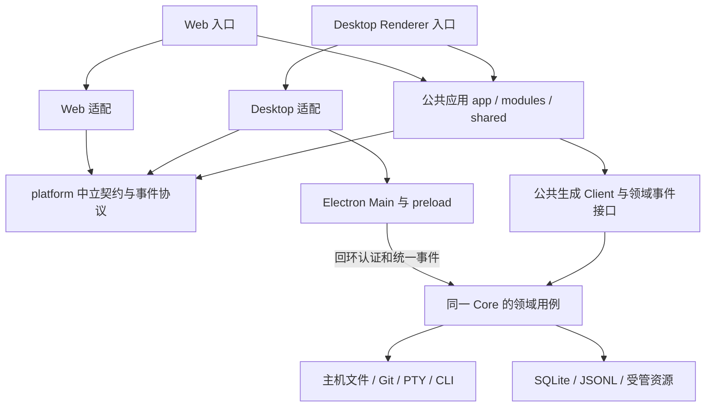
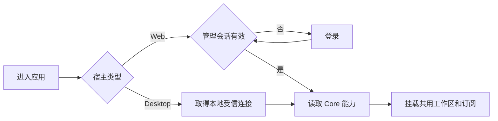
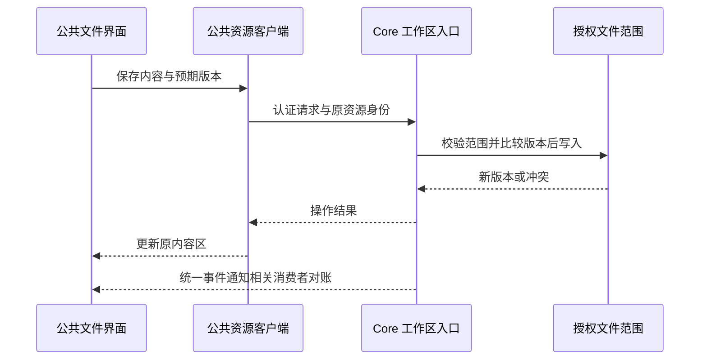

# Desktop、Web 与公共应用拆分改造方案

> 状态：待评审方案，尚未实施。基于当前工作区源码，包括已有未提交修改；不代表当前已支持独立 Web 部署。本轮只编写方案，不修改产品代码、配置或生成文件。

## 1. 引言

### 1.1 背景

当前 React 应用、桌面入口、Electron 和前端工具链都位于 `desktop/`。业务主要通过 HTTP 访问 Go Core，但文件、Git、PTY、原生网页视图和部分事件能力由 Electron 主进程持有。直接复制前端到 `web/` 会产生两套业务实现；仅隐藏窗口按钮又无法消除运行依赖。

### 1.2 目的与建议基线

形成两个独立交付入口、一套公共业务界面和一个 Core。Desktop 保留本机原生体验，Web 无需安装或启动 Electron。公共部分按业务和平台能力边界共享，不按通用函数数量机械拆包。

本方案建议先支持单实例、单管理员的自托管 Web；浏览器与服务端处于不同机器时，项目、Git、CLI 和执行工作区均属于服务端主机。多个浏览器会话共享该实例的数据，不代表多用户权限隔离。该部署基线是方案建议，尚未由用户确认。

目标包括核心业务、文件工作台、Git 和交互终端的分阶段适配。任意网站的原生内嵌浏览器不作为 Web 首版等价承诺；Web 使用外部标签页，受管 HTML 产物另行提供隔离预览。移动端布局、多租户、访问浏览器所在电脑的任意目录、桌面客户端连接远端 Core，均不纳入此次默认范围。

### 1.3 参考依据

- [架构总览](../../architecture/overview-cn.md)、[桌面边界](../../architecture/desktop-lifecycle-cn.md)、[通知与工作看板](../../architecture/notifications-and-work-board-cn.md)、[存储边界](../../architecture/workspace-and-storage-cn.md)。
- [Renderer 启动](../../../desktop/src/main.tsx)、[桌面适配](../../../desktop/src/shared/desktop/index.ts)、[IPC 契约](../../../desktop/electron/shared/contracts.ts)、[全局事件适配](../../../desktop/src/shared/api/global-events.ts)。
- [文件范围服务](../../../desktop/electron/main/workspace-resource-scope.ts)、[Git](../../../desktop/electron/main/scoped-git.ts)、[终端](../../../desktop/electron/main/terminal-manager.ts)、[Core 入口](../../../server/cmd/ally-core/main.go)。
- [管理路由](../../../server/apis/root.go)、[本地认证](../../../server/apis/middleware/local_token_auth.go)、[API 集成设计](2026-10-21-api-integration-design.md)。

## 2. 需求范围

未提供外部需求编号。评审对象是目录和依赖边界、两端运行职责、渐进迁移顺序及每阶段完成条件；不展开到完整接口字段和实施任务清单。

## 3. 总体设计

### 3.1 当前实现与变化

| 当前实现                                                           | 拆分含义                                               |
| ------------------------------------------------------------------ | ------------------------------------------------------ |
| `desktop/src/app`、`modules`、`shared` 保存业务 UI、查询与基础组件 | 主要迁到公共应用，不在 Web 复制页面                    |
| `shared/desktop` 同时承担连接、原生能力和浏览器降级                | 拆成平台契约、两端适配与公共 API 实现                  |
| Renderer 引用 `electron/shared` 的类型、事件客户端和文件限制       | 中立协议上移，IPC 专属契约仍留在桌面                   |
| Core 连接限制为 HTTP 回环地址，浏览器开发模式使用 Vite 环境令牌    | 保留桌面约束，为 Web 单独建立同源会话访问模式          |
| 文件、Git、PTY 的服务实现位于 Electron                             | 最终迁到 Core，两端共享同一实现                        |
| Core 已有独立入口，桌面父进程监控按环境变量启用                    | 服务部署不设置桌面父进程，独立管理启动、退出和资源路径 |
| 浏览器已有业务事件连接；文件事件仍直接依赖原生观察                 | 复用事件恢复逻辑，补服务端文件/Git 事件                |
| API 集成有独立监听及按资源授权的 Key                               | 保持对外集成边界，不能以该 Key 替代完整管理界面的认证  |
| 工作区、生成器和检查脚本多处写死 `desktop/`                        | 代码迁移必须同步工具链，不能只移动目录                 |

### 3.2 目标目录与所有权

以下目录为拟新增或调整的目标结构：

```text
desktop/
  src/                     # 桌面 Renderer 薄入口和平台适配
  electron/                # Main、preload、IPC、窗口、托盘、原生网页视图
  resources/               # 桌面安装包资源输出
  package.json             # 桌面构建、检查和安装包
web/
  src/                     # Web 薄入口、会话入口和浏览器适配
  package.json             # Web 独立开发、构建和检查
  deploy/                  # 同源反向代理与服务启动示例
packages/
  app/
    src/app/               # 路由、Scene、启动协调、跨模块装配
    src/modules/           # 所有共用业务页面、工作台和业务查询
    src/shared/            # UI、样式、i18n、API Client、事件与诊断
    public/                # 共用静态源资源
    vendor/                # 当前共用渲染依赖及许可
  platform/
    src/                   # 中立能力契约、事件协议与运行环境无关的传输逻辑
  pi-bridge/               # 从 desktop/pi-bridge 迁出的服务执行资源构建包
server/
  apis/                    # 原业务 API、拟新增管理会话及工作区 API
  internal/                # 工作区、Git、PTY 等底层能力，按职责形成深模块
  services/                # 仅放存在多个真实入口复用的业务及生命周期机制
scripts/                   # 两端共用的构建、生成、检查配置与工具
```

不另建全局 `common`、`utils`、独立 UI 库或第二份 API SDK。API 生成结果只保留在公共应用一处；当前 `desktop/vendor` 中共用渲染资源连同消费者迁移，桌面独有资源留下。源图和伙伴素材由公共应用维护唯一来源，图标、托盘图和安装包资源仍由生成命令输出。插件源与服务资源沿用已有生成入口，生成结果按交付目标放置。

`packages/platform` 不持有业务状态、不定义业务页面，不导入 React 应用、Electron 或 Node；它只接收本次两端实际需要的契约与中立事件实现。禁止把现有 65 个 IPC 命令原样包装成一个新的万能平台对象。

| 能力                                             | Desktop                            | Web                            | 公共部分／Core                                      |
| ------------------------------------------------ | ---------------------------------- | ------------------------------ | --------------------------------------------------- |
| 路由、聊天、伙伴、团队、工作流、知识库、设置业务 | 装配公共应用                       | 装配同一公共应用               | 页面、查询、组件、业务规则只维护一份                |
| 窗口、拖动区域、托盘、桌面安装包更新             | Electron 负责                      | 不提供相应入口及预留空白       | Shell 根据能力装配，不硬编码 macOS 占位圆点         |
| 连接与认证                                       | preload 提供受信回环地址和本地令牌 | 同源地址和 Web 会话            | 公共 API 通过连接策略初始化，不自行发现 Electron    |
| 外链、保存到用户电脑、选择上传文件               | 原生对话框、系统浏览器             | 浏览器标签页、File、Blob、下载 | 共用业务意图，宿主实现各自交互                      |
| 项目和工作范围                                   | 指向桌面 Core 所在主机目录         | 指向部署主机的获准目录         | Core 维护唯一授权与冻结范围；上传目录不自动成为项目 |
| 文件 CRUD、预览字节、搜索、文件监听              | 最终通过 Core API                  | 通过 Core API                  | Core 唯一执行；编辑器和预览器留在公共应用           |
| Git 状态、历史、分支与写操作                     | 最终通过 Core API                  | 通过 Core API                  | Core 绑定工作范围和仓库；公共界面共用               |
| 交互终端                                         | 最终消费 Core PTY 会话             | 消费 Core PTY 会话             | Core 持有 PTY；公共应用维护终端展示                 |
| 任意网站内嵌                                     | 保留原生视图                       | 首版打开外部标签页             | 不能假设 iframe 可嵌入所有网站                      |
| 受管 HTML 产物                                   | 保留受限原生预览                   | 服务端授权读取、隔离预览或下载 | 不把产物脚本放到管理应用同源权限中运行              |
| 业务事件和通知                                   | Main 的统一 WS，经 IPC 转发        | 每个页面实例一条统一 WS        | 同一协议、快照恢复和通知语义；不额外维护业务事实    |
| Runtime、账号、插件、调度与持久化                | 运行于本地 Core 主机               | 运行于服务器                   | Go Core 与既有 Runtime 适配负责                     |

目标依赖方向：



Desktop 与 Web 不互相导入。公共应用不能引用 `desktop/`、`web/`、`electron/`、`window.allyDesktop` 或 Node。两端在挂载前注入明确的平台实现；中立接口按连接、宿主操作、资源访问、终端、网页视图分别组织。先在原目录建立边界，再移动代码。

## 4. 外部契约

### 4.1 管理访问和对外集成

建议由同一 Go Core 进程提供可选 Web 管理入口，复用领域处理器；原本地管理入口保留回环令牌校验，对外集成监听及资源 Key 保留原有用途。三类入口分别鉴权，不通过全局放宽本地令牌中间件实现 Web 支持，也不为 Web 再启动一套调度器和数据库所有者。

生产建议同源部署：反向代理承载 HTTPS 和静态文件，将管理 API、登录与 WS 转到仅在受控网络监听的 Core Web 入口；原本地入口不直接暴露给公网。Web 会话建议采用单管理员登录、服务端会话、HttpOnly/Secure/SameSite Cookie，并对写请求检查 Origin 和 CSRF。管理员凭据通过部署配置初始化，密码哈希配置与运行会话分开；默认拒绝未配置认证的 Web 启动。具体登录凭据来源和首次设置方式须在第 3 阶段前确认，不影响前两阶段拆分。

会话在 Core 进程内持有，具有明确超时；重启要求重新登录，不增加第二份业务用户数据库。退出和过期应终止相关事件／终端附件的访问权限；不会取消已接纳业务执行。Web WS 握手检查管理会话和精确 Origin，不把令牌放入 URL；认证失败进入登录恢复，不永久重连。

Web 的构建及启动配置仅包含非敏感地址、版本等信息，不将 `ALLY_LOCAL_TOKEN`、管理员密码或集成 Key 写入 Vite 变量和静态产物。不把当前用于浏览器开发的默认令牌带到部署模式。公共连接策略区分本地 Bearer 与同源会话，凭据只应用到该管理入口，不能转发到第三方资源。

### 4.2 接口变化范围

下表是拟新增能力及建议命名，精确路由和字段在对应阶段实施设计中冻结，不代表已实现接口。

| 范围                                   | 操作                                             | 变化                                                                     |
| -------------------------------------- | ------------------------------------------------ | ------------------------------------------------------------------------ |
| 原伙伴、Chat、工作流、知识库等管理 API | 原 CRUD                                          | 复用原 Operator、响应、分页及业务身份；Web 入口使用独立管理会话校验      |
| Web 管理会话                           | 登录、查询当前会话、退出                         | 新增最小会话入口，不能复用 AI 账号登录或集成 Key 作为管理员身份          |
| 工作区范围                             | 获取可访问根与能力                               | 服务端从 Chat／冻结范围推导；客户端不能自行提交绝对路径扩大范围          |
| 文件资源                               | 上传、列表、读取、下载、版本化写入、重命名、删除 | 补齐通用工作区 API；复用已有适用领域文件接口，不跨 Chat/Run 混用文件身份 |
| Git                                    | 状态、历史、差异、分支、暂存、提交等             | 从 Main 迁到受范围约束的 Core 入口                                       |
| 终端                                   | 创建、附着、输入、调整大小、分离、关闭           | 新增 Core 会话和流协议；创建不等同于重新创建原业务执行                   |
| 事件                                   | 工作区和 Git 失效事件                            | 注册到统一通道，保留序号、断线对账和有界缓冲                             |

例如，拟提供的文件写入可表达为 `PUT /api/v1/chats/{chatId}/workspace/files/{fileId}`，请求只包含相对内容身份、正文和 `expectedVersion`；不接收任意写入根目录。成功响应提供界面继续编辑确实需要的新版本；并发冲突不能覆盖服务端最新内容。最终采用稳定 `fileId` 还是经过编码的相对路径，由文件阶段结合现有引用解析确认。

```json
{ "content": "更新后的文件正文", "expectedVersion": "opaque-version-1" }
```

```json
{ "version": "opaque-version-2" }
```

上述 JSON 仅示意核心字段，最终沿用项目生成契约和响应约定。列表沿用所属领域的分页请求／响应；目录枚举采用有界结果及明确截断标记，不能把截断结果视为完整目录。上传接收文件名和字节，在服务端生成资源身份并绑定草稿／Chat／Run；不能把浏览器文件路径当成服务器路径。Chat 创建前的附件需要临时上传身份、接纳时归属校验和取消／过期清理，不能只设计已有 Chat 的上传接口。

终端允许独立于业务事件使用受认证的双向数据流，承载有背压要求的 PTY 字节，不在统一业务 WS 中逐字推送。会话状态和业务资源失效仍走统一事件。关闭终端内容释放所属会话；网络断开只分离附件，留有有界重连窗口，超时回收，不能因普通网页刷新取消 Chat 执行。

## 5. 功能与迁移设计

### 5.1 功能逻辑

#### 5.1.1 权限、能力和状态

平台能力分开表达：宿主是否有原生窗口／文件选择／嵌入视图，以及服务端是否支持工作区写入／Git／终端。服务能力从经过认证的 Core 能力声明读取，不在 Web 配一份独立业务开关。初始能力未知时不展示不可执行操作；认证过期、离线和不支持不能互相冒充。

页面只根据明确能力装配入口；不支持的动作隐藏，保留内容价值的只读区域仍可显示。打开旧链接或旧工作台标签时，在原内容区说明不可用并给出适用操作。禁止通过空数组、空正文或假成功掩盖未实现能力；不能因一个桌面能力缺失而阻止整个工作区挂载。能力标志只影响交互，API 仍校验实际授权。

Web 的项目选择应明确标注服务器目录，限制在部署者允许管理的根目录集合；首版可由部署者预配置项目根，不默认提供全盘浏览。冻结工作范围仍由原领域用例维护。文件资源逐次校验真实路径、软链接、归属及读写权限；旧 Main 中的约束迁入 Go 时同时迁移测试。已有知识库本地／远端 adapter 表达知识资源后端，与 Desktop／Web 宿主是两个独立维度，不合并成平台开关。

#### 5.1.2 启动、登录和事件

公共启动协调保留主题、品牌资源准备、错误重试和工作区延迟加载。Desktop 注入本机连接并保留现有安装探测；Web 先完成管理会话，再核查服务器 Runtime 状态。不能按访问者电脑的操作系统生成服务器安装命令，Web 未配置 Runtime 时显示服务器配置入口。

业务查询和页面状态仍使用公共 TanStack Query；每个应用实例只持有一份 Query Client。退出或切换实例必须释放连接、范围句柄和订阅，并清除原实例缓存，避免旧响应或缓存越界；Phase 3 首版只支持同源单实例，不新增任意服务器切换 UI。



Core 业务事件的共享协议、解码、去重与恢复逻辑上移中立包。Desktop 继续由 Main 持有统一 WS，Renderer 不新增直连；Web 每个页面实例直接持有统一 WS。REST 认证、WS 认证、Origin 和断线恢复必须在同一阶段适配。现有请求拦截器里的回环重定向条件需要一并修改为受信连接策略，不能只改 `getCoreConnection()`。



#### 5.1.3 数据与运行资源归属

| 数据／资源                                       | 所有者与迁移规则                                                    |
| ------------------------------------------------ | ------------------------------------------------------------------- |
| 业务 SQLite、Chat JSONL、memory.db、资源安装状态 | 原 Core；单纯源码移动不改表、不改 ID、不复制数据库                  |
| 工作范围、账号和 Runtime 状态                    | 原领域与服务器；Web Cookie 不替代模型账号授权                       |
| Web 管理凭据及临时会话                           | 拟新增管理入口的部署配置／进程内会话；不混入集成 Key 表或 AI 账号表 |
| 文件范围句柄、观察者与取消请求                   | 最终由 Core 持有；进程重启后重建，不把旧 Main 句柄直接当作远端授权  |
| PTY 会话与附着关系                               | 最终由 Core 生命周期管理；终端输出不成为另一份业务执行日志          |
| 公共 API SDK 与事件协议                          | 单一生成结果和中立协议源；不为两端维护副本                          |
| Pi bridge、插件、allycli、技能与许可             | 服务执行交付资源；两种部署使用同一生成源，按目标平台打包            |

服务部署显式设置数据根、受管文件根、项目根、CLI 和资源位置，并交付实际需要的 Node/Python/CLI 依赖。搬到服务器不是透明迁移本机目录：跨主机迁移须停止写入或使用一致性备份，复制关联数据、日志和资源，显式确认路径映射并重新核查已有冻结范围；不静默改绑运行中的工作，也不让桌面和服务器进程同时管理同一数据目录。

#### 5.1.4 分阶段迁移

按阶段单独验收；结构移动与行为迁移分开提交。以下是建议顺序，阶段进入条件明确，不表示已获实施批准。

| 阶段                 | 主要改动                                                                                                                                 | 该阶段完成条件                                                                                                               |
| -------------------- | ---------------------------------------------------------------------------------------------------------------------------------------- | ---------------------------------------------------------------------------------------------------------------------------- |
| 0：冻结迁移清单      | 基于当前未提交状态登记公共代码、桌面能力、生成资产、依赖及路径脚本；记录现有检查结果，不覆盖并行知识库/API 改动                          | 形成可复核的迁移映射、资产及依赖清单；已有失败与新增失败分开                                                                 |
| 1：先建立边界        | 原目录中引入窄平台契约和注入入口；将中立事件协议／客户端、字节限制和通用资源类型移出 Electron；Desktop 实现仍调用旧 Bridge               | 公共候选代码不再直接依赖 `electron/shared` 或全局桥；原桌面行为和许可不变；契约与行为回归通过                                |
| 2：抽取公共应用      | 搬迁业务 app/modules/shared、测试、样式、i18n、共用 vendor/public 与唯一 SDK；Desktop 变薄入口；同步工作区、别名、生成器、检查及资产路径 | 桌面完整检查通过；生成结果可重复；原安装包资源齐全；Web 候选依赖图没有 Electron、node-pty 或桌面运行依赖                     |
| 3：独立 Web 核心业务 | 新增 `web/`；实现同源管理会话、API/WS 策略、能力声明、Web 宿主适配和部署资源；移出 Pi bridge 的桌面归属；提供无 Electron 的 Core 部署    | 浏览器完成登录、伙伴／Chat 操作、实际执行、审批、事件恢复和成果读取；关闭网页执行继续；不支持的文件/Git/终端入口不误报空数据 |
| 4：迁文件与观察      | 补齐含发送前暂存的附件上传和受管文件 CRUD；迁真实路径、版本、取消、文件/Git 失效观察；Desktop/Web 共用 Core 资源客户端                   | 上传、下载、编辑冲突、越界软链接和断线对账通过；桌面同等操作切到新入口后，删除对应 Main 实现，不保留长期双写                 |
| 5：迁 Git 与 PTY     | Git 读接口先迁，再迁写操作；PTY 生命周期、附着和流协议迁到 Core；两端保留共用展示                                                        | Git 操作严格绑定范围和仓库；终端输入／背压／重连／关闭／Core 退出通过；删除对应旧 IPC 服务                                   |
| 6：收尾与正式交付    | 完成入口和依赖规则、两端 CI、部署与回退说明；处置旧标签、旧文件引用和剩余桌面分支；补充当前能力文档                                      | 独立 Web 构建安装不拉起或执行 Electron 安装脚本；服务运行不依赖桌面目录或进程；Desktop 回归与目标部署验收分别通过            |

第 3 阶段是受限的核心业务 Web 里程碑；第 4、5 阶段完成后才能称文件工作台、Git、终端已脱离桌面。第 3 阶段真实执行可使用预配置服务器项目和文本输入；发送附件与完整生成文件浏览要到第 4 阶段，不能把该阶段交付描述为功能等价版本。

每种能力在一个交付版本中只选择一个实际实现；迁移某项能力时，两端按能力声明和服务版本选择对应实现，不在失败后自动回退到另一个主机或执行器。过渡期允许原 `shared/desktop` 导出代理到新契约，必须在第 2 阶段结束前删除；后续不以无限期兼容层保留旧目录依赖。

第 4、5 阶段按能力小批迁移，每批先使 Go 服务和客户端契约就绪，完成桌面切换与行为回归后再移除该批 IPC。Desktop 与附带 Core 同版本发布；Web 静态资源和 Core 原子发布，跨版本不支持时明确报错，不靠缺字段猜测兼容。

#### 5.1.5 工具链和验证

- 单一 pnpm workspace 与锁文件，增加 `web` 和公共包。React 等共用运行依赖确保单实例；Electron、node-pty 仅属于桌面或相应服务目标，不进入浏览器包。根开发依赖不能隐式依靠 `desktop/node_modules`。
- 两端复用 Vite 的 React/Tailwind/PDF.js 资产和图模块分包配置；桌面保留相对资源和协议要求，Web 首版按域名根路径部署并沿用 Hash Router，不额外叠加路由重写与子路径支持。迁移品牌绝对路径时同时核查 SVG、伙伴素材、PDF CMaps/fonts/WASM、worker 和样式扫描范围。
- API 生成入口和 `api:check` 同步迁到公共应用；仅运行生成器更新产物。工作流 presentation 的源码入口、摘要生成、测试夹具、许可、Pi bridge 产物及图标生成路径同时核查。
- UI 策略、ESLint、TypeScript、Vitest、格式化和文档脚本覆盖公共目录及两端入口；新增真正的包依赖规则，包括相对路径，不能因迁出 `desktop/src` 而漏检。构建配置可使用 Node，浏览器生产代码不得借此放宽。
- 保留桌面现有启动预算：入口 500,000 bytes，实际启动依赖 4,500,000 bytes。适配迁移后 manifest 键与动态图，不删除启动时实际等待的代码来绕过预算；Web 独立测量同一口径，并以相同上限作为首版建议值。
- 保留根 `pnpm check` 与 `pnpm api:check` 入口；拟新增公共应用检查与 `pnpm --dir web check`，桌面命令继续覆盖公共应用及桌面特有检查。运行时为 Node 25 且出现 Web Storage 冲突时，使用已知兼容参数，不把环境故障视为业务回归。
- 修改 Go 时执行 gofmt、`go vet ./...` 和 `go test ./...`；对新远程边界覆盖认证、权限、版本冲突、取消与恢复。浏览器字节流需核查编码和大小上限，不把现有 IPC 的 TypedArray 序列化方式直接照搬成 HTTP JSON。
- 文件阶段检查所有共用消费者：Chat、工作台 Office/PDF、插件／技能导入、角色模板、知识原件下载和工作流产物；已有领域 HTTP 上传下载不应退化为新的重复接口。
- 真实验收分别覆盖目标服务器 CLI、设备授权／OAuth、模型执行、Git、PTY 及 Desktop 原生视图。设备授权和本机回调式 OAuth 分开核查，远端机器不能接收访问者电脑的 localhost 回调。静态检查不等于账号登录或目标系统支持已验证。

### 5.2 性能与风险

公共界面复用本身不应增加第二份 React 或业务连接。主要新增成本来自远程文件字节传输、Git 扫描、PTY 流和多浏览器会话订阅。文件读取有大小上限、取消和按需加载；监听按范围共享；终端有背压、缓冲和附件数量限制。具体并发上限和容量由对应阶段测量，不在本方案承诺吞吐量。

最大的回归风险是文件真实路径授权与版本冲突语义从 Node 迁到 Go，以及工具脚本漏检新目录。最大的部署不确定性是服务器操作系统和 Runtime/插件兼容；侧车打包现有目标主要面向 macOS/Windows，不能据此承诺 Linux 所有插件均可用。Linux 支持必须核查目标二进制、账号登录、终端和资源构建后再列为已支持。

### 5.3 升级与回退

前两阶段保持业务协议和存储不变，按提交回退目录和工具链，不回退用户业务数据。Web 功能默认关闭，配置认证与部署后显式开启；桌面无需启动 Web 监听。公共 UI 的结构迁移不改变现有 Chat/Run/项目身份。

后续能力迁移保留原数据布局；切换前释放原范围句柄、观察与终端附件，由新实现按原业务身份重建。活跃交互终端不跨进程热迁移，阶段切换安排终端关闭或明确的维护窗口；后台执行按原 Core 有序退出和恢复机制处理，不许以终端迁移暗中取消。

回退使用对应版本的静态文件与 Core；必要时关闭 Web 入口，保留原桌面使用。跨主机或实际新增存储前先建立可恢复的一致性备份；不把前端包回退视为数据库和路径迁移已回退。数据恢复、CLI 凭据可迁移性及路径映射须在真实迁移前单独确认。

### 5.4 继承性分析

1. 是否涉及网元间信元、消息变更：不涉及
2. 是否涉及话统及KPI变更：不涉及
3. 是否涉及和华为侧平台接口变更：不涉及
4. 是否涉及MML配置或者web前台操作变更：涉及，Web 宿主操作、服务器目录语义、登录和能力入口有变化。
5. 是否涉及规格负向变更：涉及，Web 首版对未迁移能力明确限制，Desktop 以原行为回归作为交付条件。
6. 是否涉及新增业务功能默认开启：涉及，新增 Web 监听默认关闭，已接纳业务不因页面关闭取消。
7. 新增功能是否前向兼容：涉及，前两阶段保留业务协议；后续新能力按客户端／Core 配套版本发布。
8. 是否涉及告警及License变更：不涉及

### 5.5 可服务性需求

1. 当前需求是否需要新增话统及KPI：不涉及
2. 当前需求是否需要新增告警：不涉及
3. 当前需求是否需要MML配置及web前台操作功能：涉及，增加部署认证、会话和服务器能力说明。
4. 当前需求是否需要批量配置功能：不涉及
5. 当前需求是否需要新增License：不涉及
6. 是否涉及信息采集：涉及，沿用诊断脱敏，区分浏览器、Core、PTY 与业务错误，不能记录会话凭据。
7. 是否涉及健康检查：涉及，部署需核查 Core、Runtime 和必需资源，不能只检查静态首页返回 200。
8. 是否涉及工具需求：涉及，生成器、构建、预算与边界检查需要覆盖公共包和两端交付。
9. 是否涉及软调或者测试补丁：不涉及
10. 功能是否与环境相关，需要在华为环境上测试：不涉及

部署主机系统、首次管理员认证方式以及是否接受第 3 阶段的受限里程碑，应在进入 Web 行为开发前确认。前两阶段边界整理不依赖这些选择；本方案未获批准前不进入实施。
